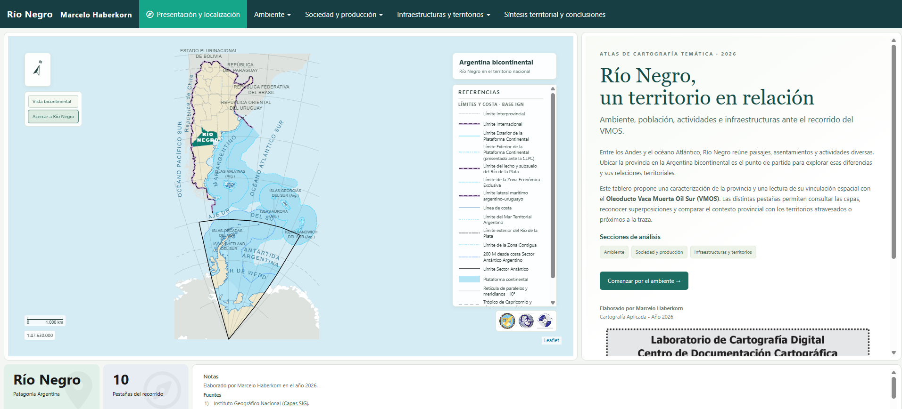
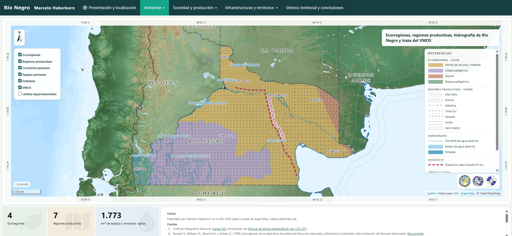
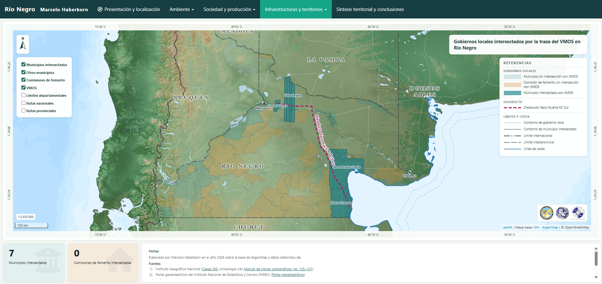

# Atlas cartográfico interactivo de Río Negro y traza VMOS

🌐 **[EXPLORAR EL ATLAS INTERACTIVO DE RÍO NEGRO–VMOS](https://marcelohaberkorn.github.io/rio-negro-vmos-atlas/)**

**Cartografía digital, análisis territorial y visualización de datos geoespaciales con R**

**Autor:** Marcelo Haberkorn

**Año:** 2026

**Tecnologías:** R · R Markdown · flexdashboard · Leaflet · sf · GeoJSON

## Versión vigente · 3 de noviembre de 2026

El enlace público muestra la revisión de cierre del atlas, organizada en **Ambiente**, **Sociedad y producción** e **Infraestructuras y territorios**, con diez pestañas y síntesis territorial.

- Presentación bicontinental en Lambert, norte geográfico dinámico y nuevos logos institucionales completos.
- Comparación NBI 2010–2022 con los mismos intervalos y colores; población 2022 contrastada con la tabla validada y universos identificados.
- Producción: existencias ovinas 2022, bovinas 2021 y superficie conjunta de peras y manzanas 2018 en hectáreas, con fuentes enlazadas.
- Ferrocarriles, estaciones, diques y balsas con simbología basada en el IGN; consultas documentadas para las cuatro estaciones contrastadas con Tren Patagónico.
- Hidrografía suavizada y selección del dibujo principal por tramos, sin opción de trazados auxiliares. Las capas de agua, diques y muros muestran nombres al pasar el cursor.
- Recorte de departamentos por el límite provincial, corrección de costa de San Antonio Oeste y rotulación areal adaptativa.
- Selector de Asentamientos con una sola zona desplazable y navegación simplificada; fuentes, aclaraciones y conclusiones revisadas.

[Historial de cambios](CHANGELOG.md) · [Detalle del cierre](REVISION_CIERRE_20261103.md) · [Controles de la versión](revision_cierre_20261103.json) · [Uso y recompilación](LEEME.md)

La fuente editable está en `Tablero_Rio_Negro.Rmd`; `docs/index.html` conserva el contenido de la salida aprobada, con los datos de cada mapa en scripts externos para su publicación. El HTML original sin modificaciones se conserva en `distribucion/Tablero_Rio_Negro.html.gz`. Para recompilar desde RStudio, ejecutar `source("Compilar_tablero.R")` en la raíz del repositorio. Para preparar la publicación, ejecutar después `python Publicar_tablero.py`. No se requiere volver a procesar las geometrías de dibujo incluidas.

## Descripción del proyecto

Este proyecto consiste en un atlas cartográfico interactivo de la provincia de Río Negro, desarrollado mediante R y tecnologías de visualización geoespacial.

El trabajo integra información ambiental, demográfica, productiva y de infraestructura territorial, tomando como uno de sus ejes de análisis la traza del proyecto Vaca Muerta Oil Sur (VMOS).

Su propósito es facilitar la exploración y la interpretación de información territorial mediante cartografía temática digital, consultas interactivas y diferentes formas de representación estadística.

## Objetivos

\- Caracterizar el territorio provincial a partir de distintas dimensiones geográficas.

\- Integrar información espacial procedente de diversas fuentes.

\- Analizar las relaciones territoriales entre la traza VMOS y diferentes componentes del territorio.

\- Aplicar criterios cartográficos rigurosos a un entorno de visualización interactiva.

\- Desarrollar un producto digital que facilite la consulta y comunicación de información geográfica.

## Contenidos del atlas

El tablero reúne diez secciones temáticas que incluyen:

\- Presentación territorial y cartografía de referencia.

\- Ecorregiones y regiones productivas.

\- Distribución de la población.

\- Necesidades Básicas Insatisfechas (NBI).

\- Actividades productivas.

\- Infraestructura eléctrica.

\- Gobiernos locales y relación espacial con la traza VMOS.

\- Organización sanitaria.

\- Localidades próximas a la traza y conectividad territorial.

\- Síntesis del análisis territorial.

## Vista previa del atlas

Las siguientes capturas corresponden a la publicación inicial de octubre de 2026 y se conservan como referencia del proyecto. Para consultar la composición y las funcionalidades vigentes, abrir el [tablero actualizado](https://marcelohaberkorn.github.io/rio-negro-vmos-atlas/).

### Presentación y localización territorial

### Ecorregiones, regiones productivas e hidrografía

### Análisis espacial de gobiernos locales y traza VMOS

## Metodología y trabajo cartográfico

El desarrollo del atlas involucró tareas de preparación, integración, procesamiento y representación de información geoespacial.

Entre los procedimientos aplicados se encuentran:

\- Organización y estandarización de capas geográficas.

\- Procesamiento de geometrías vectoriales.

\- Operaciones de selección, recorte e intersección espacial.

\- Preparación de capas para mejorar el rendimiento de la visualización.

\- Integración de atributos estadísticos y espaciales.

\- Elaboración de cartografía temática.

\- Aplicación de criterios de clasificación y simbología cartográfica.

\- Diseño de mapas interactivos con herramientas de navegación y consulta.

El producto combina criterios de la cartografía tradicional con las posibilidades de exploración de los entornos digitales.

## Herramientas utilizadas

| Herramienta | Aplicación |
|---|---|
| R | Procesamiento y análisis de información |
| R Markdown | Desarrollo reproducible del documento |
| flexdashboard | Organización del tablero interactivo |
| Leaflet | Visualización cartográfica web |
| sf | Manipulación y análisis de datos espaciales |
| GeoJSON | Almacenamiento e intercambio de información geográfica |
| HTML, CSS y JavaScript | Presentación y componentes de interacción |

## Fuentes de información

El atlas integra información geográfica y estadística de organismos e instituciones públicas, entre ellos el Instituto Geográfico Nacional (IGN) y el Instituto Nacional de Estadística y Censos (INDEC), además de otras fuentes sectoriales identificadas en la documentación técnica.

Las fuentes específicas, los años de referencia y las observaciones metodológicas se detallan en el tablero y en el archivo [LEEME.md](LEEME.md).

**Red vial nacional y provincial:** información geoespacial obtenida del Instituto Geográfico Nacional de la República Argentina (IGN), a través del [Centro de Descargas de Capas SIG](https://www.ign.gob.ar/NuestrasActividades/InformacionGeoespacial/CapasSIG). Las capas fueron utilizadas como insumo para el procesamiento y la representación cartográfica del territorio provincial. Los archivos originales pueden consultarse y descargarse desde la fuente oficial. La fecha de actualización de los datos utilizados debe verificarse en sus metadatos correspondientes.

## Alcances y limitaciones

El atlas constituye un ejercicio de análisis territorial y representación cartográfica.

La proximidad espacial entre la traza VMOS y los diferentes elementos del territorio no debe interpretarse, por sí sola, como evidencia de impactos causales, económicos, sociales o ambientales.

Los resultados deben analizarse considerando la escala geográfica, la disponibilidad de información y los períodos de referencia de cada fuente.

## Documentación técnica

Para consultar los aspectos metodológicos, las fuentes y los requisitos de ejecución del proyecto, ver [LEEME.md](LEEME.md).

## Autoría

**Marcelo Haberkorn**

Cartografía y análisis de información geoespacial

Río Negro, Argentina

[Perfil profesional en GitHub](https://github.com/marcelohaberkorn)

\---

*Proyecto desarrollado en el marco de una actividad académica de cartografía aplicada. Su publicación en este repositorio tiene fines de documentación técnica y presentación profesional de las capacidades desarrolladas por su autor.*

