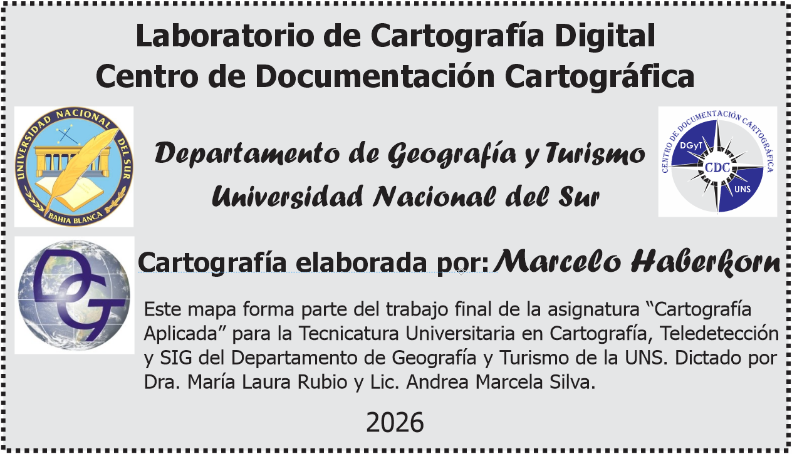

```{r setup, include=FALSE}
paquetes <- c('flexdashboard','leaflet','sf','htmltools','htmlwidgets',
              'base64enc','jsonlite','lwgeom','classInt')
faltan <- paquetes[!vapply(paquetes, requireNamespace, logical(1), quietly=TRUE)]
if (length(faltan)) stop('Instalá estos paquetes y volvé a hacer Knit: ',
                        paste(faltan, collapse=', '))
library(flexdashboard)
library(leaflet)
library(sf)
library(htmltools)
library(htmlwidgets)
knitr::opts_chunk$set(echo=FALSE, warning=FALSE, message=FALSE)
# Redondeo sólo de la representación JSON para Leaflet, a 5 decimales (resolución de pantalla).
# Los GeoJSON y las operaciones de análisis conservan su precisión de origen.
options(htmlwidgets.TOJSON_ARGS=list(digits=5,use_signif=FALSE))

nombres <- c('alta','media','centrales','estaciones','internacional',
             'provincial','departamental','costa','vmos','provincia',
             'ecorregiones','productivas','corrientes','espejos','embalses',
             'gobiernos','buenos_aires','sanitarias','asentamientos',
             'vial_nacional','vial_provincial','departamentos')
archivos <- file.path('data', paste0(nombres,'.geojson'))
if (any(!file.exists(archivos))) stop(
  'Faltan archivos. Extraé el ZIP completo y conservá la carpeta data junto al Rmd: ',
  paste(archivos[!file.exists(archivos)], collapse=', '))
capas <- setNames(lapply(archivos, function(p) {
  d <- st_read(p, quiet=TRUE)
  d <- st_zm(d, drop=TRUE, what='ZM')
  st_transform(d, 4326)
}), nombres)
capas$estaciones <- suppressWarnings(st_cast(capas$estaciones,'POINT'))

campo <- function(d, nombre, defecto='') {
  i <- match(tolower(nombre),tolower(names(d)))
  if (is.na(i)) return(rep(defecto,nrow(d)))
  v <- as.character(d[[i]])
  v[is.na(v) | !nzchar(v)] <- defecto
  v
}
esc <- function(s) as.character(htmlEscape(as.character(s)))
numero <- function(v, decimales=0) formatC(v, format='f', digits=decimales,
                                         big.mark='.', decimal.mark=',')
estilo <- function(label,color,weight,dash='') {
  list(label=label,color=color,weight=weight,dash=dash)
}
estilos <- list(
  internacional=estilo('Límite internacional','#363A39',2,'18 4 3 4 3 4'),
  provincial=estilo('Límite interprovincial','#494E49',1.6,'18 5'),
  departamental=estilo('Límite interdepartamental','#6D736E',1.2,'8 5'),
  costa=estilo('Línea de costa','#2477B3',1.8),
  media=estilo('Línea de media tensión','#CE9B32',1.2),
  alta=estilo('Línea de alta tensión','#A14915',2.5),
  vmos=estilo('Oleoducto Vaca Muerta Oil Sur','#A21F65',3.4,'10 5'),
  contorno_gl=estilo('Contorno de gobierno local','#64857D',.55),
  contorno_gl_seleccion=estilo('Contorno de municipio intersectado','#32655E',1.3),
  corrientes=estilo('Corriente de agua perenne','#267FA7',.9)
)

# Unificación gráfica solicitada; los atributos VLJ de origen se conservan.

tecnologia <- campo(capas$centrales,'TECNOLOGIA','Sin dato')
nombre_central <- campo(capas$centrales,'NOMBRE','Central')
potencia <- suppressWarnings(as.numeric(gsub(',', '.', campo(
  capas$centrales,'POTENCIA_I',NA_character_))))
tipo_central <- ifelse(grepl('hidro',tecnologia,ignore.case=TRUE),'Hidroeléctrica',
  ifelse(grepl('e[oó]lic',tecnologia,ignore.case=TRUE),'Eólica',
    ifelse(grepl('t[eé]rm|diesel|di[eé]sel|gas|vapor',tecnologia,ignore.case=TRUE),
           'Térmica','Otra / sin especificar')))
colores_central <- c('Hidroeléctrica'='#147D9B','Eólica'='#278266',
                     'Térmica'='#A14915','Otra / sin especificar'='#737B84')
nombre_estacion <- campo(capas$estaciones,'NOMBRE','Estación transformadora')

eco_nombre <- campo(capas$ecorregiones,'NOMBRE','Sin nombre')
eco_paleta <- c('Monte de llanuras y mesetas'='#D4B365',
                'Estepa patagónica'='#B2A1C7','Espinal'='#C98E78',
                'Bosque patagónico'='#76A68B')
eco_colores <- unname(eco_paleta[eco_nombre])
eco_colores[is.na(eco_colores)] <- '#A8AFAB'
prod_nombre <- campo(capas$productivas,'nam','Sin nombre')
prod_ids <- paste0('productiva-',seq_len(nrow(capas$productivas)))
eco_ids <- paste0('ecorregion-',seq_len(nrow(capas$ecorregiones)))
prod_clave <- as.character(match(prod_nombre,c(
  'Andina','Alto Valle','Norte','Valle Medio','Noreste','Línea Sur','Atlántica')))

# Tramas nominales: orientación y forma, sin progresión de densidad.
tramas <- list(
  '1'=list(size=12, svg='<path d="M-3 3 L3 -3 M0 12 L12 0 M9 15 L15 9" fill="none" stroke="#4C455B" stroke-width=".8" stroke-opacity=".55"/>'),
  '2'=list(size=12, svg='<path d="M-3 9 L3 15 M0 0 L12 12 M9 -3 L15 3" fill="none" stroke="#4C455B" stroke-width=".8" stroke-opacity=".55"/>'),
  '3'=list(size=10, svg='<path d="M0 5 H10" fill="none" stroke="#4C455B" stroke-width=".9" stroke-opacity=".55"/>'),
  '4'=list(size=10, svg='<path d="M5 0 V10" fill="none" stroke="#4C455B" stroke-width=".9" stroke-opacity=".55"/>'),
  '5'=list(size=12, svg='<circle cx="6" cy="6" r="2" fill="#4C455B" fill-opacity=".55"/>'),
  '6'=list(size=12, svg='<circle cx="6" cy="6" r="2.3" fill="none" stroke="#4C455B" stroke-width=".85" stroke-opacity=".55"/>'),
  '7'=list(size=14, svg='<path d="M7 3 V11 M3 7 H11" fill="none" stroke="#4C455B" stroke-width="1.1" stroke-opacity=".55"/>')
)

# Indicadores estáticos para la provincia completa, no para la vista del mapa.
# Unión previa para no contar dos veces superficies comunes a lagos y embalses.
agua_geometria <- c(st_geometry(capas$espejos),st_geometry(capas$embalses))
agua_m2 <- st_area(st_union(st_transform(agua_geometria,6933)))
agua_km2 <- sum(as.numeric(agua_m2))/1e6

# Selección espacial reproducible, sin buffer de proximidad.
# El cálculo usa una proyección local para operaciones topológicas.
crs_analisis <- '+proj=aeqd +lat_0=-40 +lon_0=-67 +datum=WGS84 +units=m +no_defs'
gl_nombre <- campo(capas$gobiernos,'nam','Sin nombre')
gl_categoria <- campo(capas$gobiernos,'cat_gl','Sin dato')
if (any(!gl_categoria %in% c('MU','CF'))) stop(
  'Revisar las categorías de gobiernos locales: se esperan MU y CF.')
gl_tipo <- ifelse(gl_categoria=='MU','Municipio','Comisión de Fomento')
gl_analisis <- st_transform(capas$gobiernos,crs_analisis)
prov_analisis <- st_union(st_geometry(st_transform(capas$provincia,crs_analisis)))
traza_analisis <- st_intersection(
  st_union(st_geometry(st_transform(capas$vmos,crs_analisis))),prov_analisis)
gl_intersecta <- lengths(st_intersects(gl_analisis,traza_analisis))>0
gl_km <- vapply(seq_len(nrow(gl_analisis)),function(i) {
  if (!gl_intersecta[i]) return(0)
  segmento <- suppressWarnings(st_intersection(st_geometry(gl_analisis[i,]),
                                               traza_analisis))
  if (!length(segmento)) return(0)
  sum(as.numeric(st_length(segmento)))/1000
},numeric(1))
gl_ids <- paste0('gobierno-',seq_len(nrow(capas$gobiernos)))
gl_grupos <- ifelse(gl_intersecta,
                    ifelse(gl_categoria=='MU','Municipios intersectados',
                           'Comisiones intersectadas'),
                    ifelse(gl_categoria=='MU','Otros municipios',
                           'Comisiones de fomento'))
gl_colores <- ifelse(gl_categoria=='MU','#177E89','#CC8C3A')
gl_opacidad <- ifelse(gl_intersecta,.64,ifelse(gl_categoria=='MU',.16,.30))
gl_total_mu <- sum(gl_intersecta & gl_categoria=='MU')
gl_total_cf <- sum(gl_intersecta & gl_categoria=='CF')

zs_nombre <- trimws(campo(capas$sanitarias,'Zona','Sin nombre'))
zs_analisis <- st_transform(capas$sanitarias,crs_analisis)
zs_intersecta <- lengths(st_intersects(zs_analisis,traza_analisis))>0
zs_km <- vapply(seq_len(nrow(zs_analisis)),function(i) {
  if (!zs_intersecta[i]) return(0)
  tramo <- suppressWarnings(st_intersection(st_geometry(zs_analisis[i,]),traza_analisis))
  sum(as.numeric(st_length(tramo)))/1000
},numeric(1))
zs_ids <- paste0('sanitaria-',seq_len(nrow(capas$sanitarias)))
zs_paleta <- c('Andina'='#87ADCA','Alto Valle Este'='#D3B96F',
  'Alto Valle Oeste'='#AA8FBE','Sur'='#C5A0AD','Atlántica'='#86B7A3',
  'Valle Medio'='#D99A76')
zs_colores <- unname(zs_paleta[zs_nombre])
if (anyNA(zs_colores)) stop('Revisar nombres de zonas sanitarias y paleta nominal.')
zs_grupo <- ifelse(zs_intersecta,'Zonas intersectadas','Otras zonas')
zs_opacidad <- ifelse(zs_intersecta,.78,.61)
zs_total <- length(unique(zs_nombre))
zs_total_intersectadas <- sum(zs_intersecta)
zs_porcentaje <- 100*zs_total_intersectadas/zs_total

# Distancia mínima elipsoidal WGS84: no usar grados ni Web Mercator para el umbral.
capas$asentamientos <- suppressWarnings(st_cast(capas$asentamientos,'POINT'))
as_nombre <- campo(capas$asentamientos,'nombre_geografico','Sin nombre')
as_tipo <- campo(capas$asentamientos,'tipo_asentamiento','Sin tipo')
as_tipos <- c('Localidad simple','Componente de localidad compuesta','Entidad','Paraje')
if(any(!as_tipo %in% as_tipos)) stop('Revisar los tipos de asentamiento de BAHRA.')
as_traza <- st_transform(traza_analisis,4326)
as_distancia_km <- as.numeric(lwgeom::st_geod_distance(
  st_geometry(capas$asentamientos),as_traza,tolerance=0))/1000
as_cerca <- as_distancia_km<=20
as_grupo <- ifelse(as_cerca,'Hasta 20 km','Más de 20 km')
as_total <- nrow(capas$asentamientos)
as_total_cerca <- sum(as_cerca)
as_porcentaje <- 100*mean(as_cerca)
as_colores <- c('Localidad simple'='#137F83','Componente de localidad compuesta'='#7555A3',
                'Entidad'='#B87E19','Paraje'='#C26B46')
as_entorno <- st_transform(st_intersection(
  st_buffer(st_transform(as_traza,crs_analisis),20000,nQuadSegs=48),prov_analisis),4326)
as_simbolo <- function(tipo,cerca=TRUE,completo=TRUE) {
  forma <- switch(tipo,'Localidad simple'='<circle cx="9" cy="9" r="4.6"',
    'Componente de localidad compuesta'='<rect x="4.9" y="4.9" width="8.2" height="8.2"',
    'Entidad'='<path d="M9 3.2 L14.8 9 L9 14.8 L3.2 9 Z"',
    'Paraje'='<path d="M9 3.4 L14.8 14.4 L3.2 14.4 Z"')
  cuerpo <- paste0(forma,' fill="',if(cerca)as_colores[[tipo]] else 'white',
    '" fill-opacity="',if(cerca)'1' else '.85','" stroke="',
    if(cerca)'#203F3E' else '#849894','" stroke-width="1.25"/>')
  if(!completo) return(cuerpo)
  paste0('<svg xmlns="http://www.w3.org/2000/svg" width="18" height="18" viewBox="0 0 18 18">',cuerpo,'</svg>')
}

# Máscara del IGN para ubicar el rótulo de Buenos Aires; no se dibuja como capa.
ba_geometria <- jsonlite::fromJSON('data/buenos_aires.geojson',
                                  simplifyVector=FALSE)$features[[1]]$geometry

vmos_partes <- suppressWarnings(st_cast(st_geometry(capas$vmos),'LINESTRING'))
vmos_partes <- vmos_partes[!st_is_empty(vmos_partes)]
vmos_rotulo <- list()
if (length(vmos_partes)) {
  i <- which.max(as.numeric(st_length(st_transform(vmos_partes,6933))))
  xy <- st_coordinates(vmos_partes[i])[,1:2,drop=FALSE]
  if (xy[1,1] > xy[nrow(xy),1]) xy <- xy[nrow(xy):1,,drop=FALSE]
  vmos_rotulo <- lapply(seq_len(nrow(xy)),function(j) unname(c(xy[j,2],xy[j,1])))
}

# Cruce por código INDEC. Los originales conservan sus atributos y sus universos.
tabla_pob<-read.csv('data/poblacion_validada_2022.csv',fileEncoding='UTF-8-BOM',
                     colClasses=c(cod_dpto='character'),check.names=FALSE)
tabla_pob<-tabla_pob[tabla_pob$cod_dpto!='Total',]
stopifnot(!anyDuplicated(tabla_pob$cod_dpto),nrow(tabla_pob)==13)
dp<-capas$departamentos
id_pob<-match(as.character(dp$CODIGO),tabla_pob$cod_dpto)
if(anyNA(id_pob))stop('Faltan departamentos en la tabla validada de población.')
dp$pob_part22<-tabla_pob$poblacion_total[id_pob]
dp$pob_u22<-tabla_pob$poblacion_urbana[id_pob]
dp$pob_rm22<-tabla_pob$poblacion_rural_total[id_pob]
dp$pob_r22<-tabla_pob$poblacion_rural_pura_R[id_pob]
dp$pob_m22<-tabla_pob$poblacion_rural_mixta_M[id_pob]
stopifnot(all(dp$pob_u22+dp$pob_rm22==dp$pob_part22),
          sum(dp$pob_part22)==747697,sum(dp$pob_22)==750768)
dp_analisis<-st_transform(dp,crs_analisis)
dp$area_km2<-as.numeric(st_area(st_transform(dp,6933)))/1e6
dp$dens_part22<-dp$pob_part22/dp$area_km2
dp$pct_rm22<-100*dp$pob_rm22/dp$pob_part22
tabla_nbi<-read.csv('data/nbi_2022_verificado.csv',colClasses=c(CODIGO='character'))
jn<-match(as.character(dp$CODIGO),tabla_nbi$CODIGO)
stopifnot(!anyNA(jn),!anyDuplicated(tabla_nbi$CODIGO),
  all(dp$HOGARES==tabla_nbi$hogares_total22[jn]))
dp$hogares_nbi22<-tabla_nbi$hogares_nbi22[jn]
dp$hogares_total22<-tabla_nbi$hogares_total22[jn]
dp$nbi_pct22<-100*dp$hogares_nbi22/dp$hogares_total22
dp$intersecta_vmos<-lengths(st_intersects(dp_analisis,traza_analisis))>0
dp$km_vmos<-vapply(seq_len(nrow(dp)),function(i){
 g<-suppressWarnings(st_intersection(st_geometry(dp_analisis[i,]),traza_analisis))
 sum(as.numeric(st_length(g)))/1000
},numeric(1))
nbi_campos<-c('NBI_HACINA','NBI_VIV_IN','NBI_CON_SA','NBI_ESCOLA','NBI_SUBSIS')
dp$nbi_suma_componentes<-rowSums(st_drop_geometry(dp)[nbi_campos])
nbi_suma_detectada<-all(abs(dp$nbi_suma_componentes-dp$NBI_TOTAL)<.011)
capas$departamentos<-dp
dp_total<-nrow(dp);dp_seleccion<-which(dp$intersecta_vmos)
dp_nombres<-as.character(dp$nam)
dp_pob_total<-sum(dp$pob_22);dp_pob_part<-sum(dp$pob_part22)
dp_pob_seleccion<-sum(dp$pob_part22[dp_seleccion])
dp_pct_seleccion<-100*dp_pob_seleccion/dp_pob_part
nbi_provincia<-100*sum(dp$hogares_nbi22)/sum(dp$hogares_total22)
nbi_seleccion<-100*sum(dp$hogares_nbi22[dp_seleccion])/sum(dp$hogares_total22[dp_seleccion])
dp_urbana<-sum(dp$pob_u22);dp_rm<-sum(dp$pob_rm22)
dp_centros<-st_coordinates(st_transform(st_point_on_surface(st_geometry(dp_analisis)),4326))

# Jenks exacto sobre 13 registros. Los ceros productivos forman su propia clase.
crear_tema<-function(campo,titulo,unidad,paleta,decimales=0,cero=FALSE,nota='',encabezado=unidad,cortes_fijos=NULL){
 v<-as.numeric(dp[[campo]]);incl<-is.finite(v)&(!cero|v>0)
 k<-min(5,length(unique(v[incl])))
 cortes<-if(is.null(cortes_fijos))classInt::classIntervals(v[incl],n=k,style='jenks')$brks else cortes_fijos
 if(any(v[incl]<min(cortes)|v[incl]>max(cortes)))stop('Los valores exceden los cortes comunes de ',titulo)
 # Jenks cierra a derecha: la igualdad con el corte queda en la clase inferior.
 clases<-findInterval(v,cortes,all.inside=TRUE,left.open=TRUE)
 colores<-grDevices::colorRampPalette(paleta)(length(cortes)-1)
 rellenos<-colores[clases];if(cero)rellenos[v==0]<-'#E7EBE5'
 leyenda<-list()
 if(cero&&any(v==0))leyenda<-list(list(kind='fill',label='0 · valor declarado',
    color='#E7EBE5',opacity=.77,group='Temática departamental',section=encabezado))
 # Redondear sólo los límites que se muestran. Se elige una unidad que no
 # cambie la pertenencia de ninguno de los 13 valores observados.
 pasos<-if(decimales==0)c(100,10,1)else c(.1,.01,.001,.0001,.00001,1e-8)
 techos<-unname(cortes[-1]);unidades<-rep(tail(pasos,1),length(techos))
 if(is.null(cortes_fijos))for(i in seq_along(techos)){
   siguiente<-if(i<length(techos))min(v[incl & clases>i])else Inf
   for(paso in pasos){
     candidato<-ceiling((techos[i]-1e-10)/paso)*paso
     if(candidato<siguiente){techos[i]<-candidato;unidades[i]<-paso;break}
   }
 }
 inicio<-floor(cortes[1]/unidades[1])*unidades[1]
 if(cero)inicio<-max(1,inicio)
 digitos_corte<-function(i)if(!is.null(cortes_fijos)||decimales==0)0 else max(1,-floor(log10(unidades[i])))
 for(i in seq_along(techos)){
   dig<-digitos_corte(i)
   texto<-if(decimales==0){
     desde<-if(i==1)inicio else techos[i-1]+1
     if(desde==techos[i])numero(desde)else paste0(numero(desde),' a ',numero(techos[i]))
   }else if(i==1)paste0(numero(inicio,dig),' a ',numero(techos[i],dig))else
     paste0('> ',numero(techos[i-1],digitos_corte(i-1)),' a ',numero(techos[i],dig))
   leyenda<-append(leyenda,list(list(kind='fill',label=texto,color=colores[i],opacity=.77,
     group='Temática departamental',section=encabezado)))
 }
 list(campo=campo,titulo=titulo,unidad=unidad,valores=unname(v),colores=unname(rellenos),
   decimales=decimales,cortes=unname(cortes),leyenda=leyenda,nota=nota)
}
# Mismos límites y paleta para comparar los totales NBI 2010 y 2022.
cortes_nbi_comunes<-c(0,5,10,15,20)
temas_atlas<-list(
 poblacion=list(
  crear_tema('pob_22','Población total · Censo 2022','Habitantes',c('#EDF1F6','#A7BCD9','#264A7C')),
  crear_tema('pob_rm22','Población en radios rurales o mixtos · 2022','Personas en viviendas particulares',c('#EDF4EA','#A0C491','#356C3E')),
  crear_tema('pob_u22','Población en radios urbanos · 2022','Personas en viviendas particulares',c('#EDF1F6','#A7BCD9','#264A7C')),
  crear_tema('dens_part22','Densidad de población en viviendas particulares · 2022','Personas / km²',c('#F1F4EA','#A4C097','#286445'),2)),
 nbi=list(
  crear_tema('nbi_pct22','Hogares con al menos una NBI · Censo 2022','% de hogares · 2022',c('#FEF0D9','#F8B873','#A34324'),2,cortes_fijos=cortes_nbi_comunes),
  crear_tema('nbi_10','Hogares con NBI · Censo 2010','% de hogares · 2010',c('#FEF0D9','#F8B873','#A34324'),2,cortes_fijos=cortes_nbi_comunes),
  crear_tema('NBI_HACINA','NBI · hacinamiento · Censo 2022','% de hogares · 2022',c('#FEF0D9','#F8B873','#A34324'),2),
  crear_tema('NBI_VIV_IN','NBI · vivienda inconveniente · Censo 2022','% de hogares · 2022',c('#FEF0D9','#F8B873','#A34324'),2),
  crear_tema('NBI_CON_SA','NBI · condiciones sanitarias · Censo 2022','% de hogares · 2022',c('#FEF0D9','#F8B873','#A34324'),2),
  crear_tema('NBI_ESCOLA','NBI · escolaridad · Censo 2022','% de hogares · 2022',c('#FEF0D9','#F8B873','#A34324'),2),
  crear_tema('NBI_SUBSIS','NBI · subsistencia · Censo 2022','% de hogares · 2022',c('#FEF0D9','#F8B873','#A34324'),2)),
 produccion=list(
  crear_tema('ovinos_22','Existencias ovinas · 2022','Cabezas',c('#F1EEDC','#C9BC75','#6D6025')),
  crear_tema('bovinos_21','Existencias bovinas · 2021','Cabezas',c('#F5EADD','#D4A572','#86522C')),
  crear_tema('PerMan_18','Superficie de peras y manzanas · 2018','ha',c('#EDF2DA','#B2CC77','#4D7726'),cero=TRUE,encabezado='Peras y manzanas (ha)')))
pie_datos<-list(provincia=list(nombre='Río Negro · viviendas particulares',
  urbana=dp_urbana,rm=dp_rm),departamentos=lapply(seq_len(nrow(dp)),function(i)
    list(nombre=dp_nombres[i],urbana=dp$pob_u22[i],rm=dp$pob_rm22[i],lat=unname(dp_centros[i,2]),lng=unname(dp_centros[i,1]))))

# Geometrías de visualización independientes de las operaciones y de las métricas.
# Se conservan las coordenadas originales para distancias e intersecciones.
for(k in names(capas)){
 p<-file.path('data','visual',paste0(k,'.geojson'))
 if(file.exists(p)){
   visual<-st_transform(st_zm(st_read(p,quiet=TRUE)),4326)
   if(nrow(visual)!=nrow(capas[[k]]))stop('Regenerá las copias visuales de ',k)
   st_geometry(capas[[k]])<-st_geometry(visual)
 }
}
# Media tensión: 31.324 tramos se combinan en un solo objeto de dibujo.
# El mapa no utiliza sus atributos; los originales completos permanecen en data.
capas$media<-st_sf(geometry=st_combine(st_geometry(capas$media)))

logo_html <- NULL
if (file.exists('assets/logo_original.png')) {
  logo <- 'assets/logo_original.png'
  logo_html <- paste0(paste0(
    '<div class="logo-recorte ',c('logo-uns','logo-dgyt','logo-cdc'),
    '" role="img" aria-label="',
    c('Universidad Nacional del Sur','Departamento de Geografía y Turismo',
      'Laboratorio de Cartografía Digital'),
    '" style="background-image:url(',logo,')"></div>'),collapse='')
}

linea <- function(m,d,k,grupo=NULL,pane='limites',peso=NULL) {
  if (!nrow(d)) return(m)
  s <- estilos[[k]]
  addPolylines(m,data=d,color=s$color,weight=if(is.null(peso))s$weight else peso,opacity=1,
    dashArray=if(nzchar(s$dash))s$dash else NULL,group=grupo,
    options=pathOptions(pane=pane,lineCap='butt',lineJoin='round'))
}
ref_linea <- function(k,grupo=NULL,seccion='Límites y costa') {
  list(kind='line',style=k,label=estilos[[k]]$label,group=grupo,section=seccion)
}
referencias_limites <- function() {
  r <- list(ref_linea('internacional'),ref_linea('provincial'))
  append(r,list(ref_linea('departamental','Límites departamentales'),
                ref_linea('costa')))
}

base_mapa <- function(opacidad_base=1,selector_base=FALSE,zoom_fino=FALSE) {
  m <- leaflet(options=leafletOptions(preferCanvas=FALSE,zoomControl=FALSE,
                                     minZoom=5,maxZoom=18,zoomSnap=if(zoom_fino).25 else 1))
  m <- addTiles(m,paste0('https://wms.ign.gob.ar/geoserver/gwc/service/tms/1.0.0/',
    'mapabase_topo@EPSG%3A3857@png/{z}/{x}/{-y}.png'),
    attribution=paste0('Mapa base: <a href="https://www.ign.gob.ar/" target="_blank">',
                       'IGN · ArgenMap</a> | © OpenStreetMap'),
    group=if(selector_base)'ArgenMap topográfico' else NULL,
    options=tileOptions(opacity=opacidad_base))
  if(selector_base) {
    m<-addTiles(m,paste0('https://wms.ign.gob.ar/geoserver/gwc/service/tms/1.0.0/',
      'mapabase_gris@EPSG%3A3857@png/{z}/{x}/{-y}.png'),group='ArgenMap gris claro',
      attribution='IGN · ArgenMap | © OpenStreetMap',options=tileOptions(opacity=1))
    m<-hideGroup(m,'ArgenMap gris claro')
  }
  for (p in list(c('departamentos',404),c('ecorregiones',405),c('productivas',410),c('sanitarias',411),c('entorno',413),c('gobiernos',412),c('agua',415),c('vial',418),
                 c('limites',420),c('red',425),c('oleoducto',430),
                 c('instalaciones',440))) {
    m <- addMapPane(m,p[1],zIndex=as.numeric(p[2]))
  }
  m
}
agregar_contexto <- function(m,departamentos=TRUE,peso_vmos=3.4,salud=FALSE) {
  m <- linea(m,capas$departamental,'departamental','Límites departamentales')
  m <- linea(m,capas$internacional,'internacional')
  m <- linea(m,capas$provincial,'provincial')
  m <- linea(m,capas$costa,'costa')
  m <- linea(m,capas$vmos,'vmos','VMOS','oleoducto',peso=peso_vmos)
  m <- addLabelOnlyMarkers(m,
    lng=c(if(salud)-67.8 else -68.8,-70.6,-65.9,-68.6,-69.0),
    lat=c(if(salud)-41.8 else -40.65,-38.8,-37.75,-42.25,-36.95),
    label=lapply(c('RÍO NEGRO','NEUQUÉN','LA PAMPA','CHUBUT',
      '<span class="nombre-mendoza">MENDOZA</span>'),HTML),
    labelOptions=labelOptions(noHide=TRUE,direction='center',textOnly=TRUE,
                               className='rotulo-provincia'))
  if (!departamentos) m <- hideGroup(m,'Límites departamentales')
  m
}
finalizar_mapa <- function(m,tema,grupos,referencias,activos=grupos,
                           tramas_mapa=list(),consulta=list(),estilos_mapa=estilos) {
  force(activos)
  if(tema %in% c('electricidad','gobiernos','sanitarias','asentamientos','poblacion','nbi','produccion','sintesis')) {
    m<-agregar_vial(m)
    grupos<-c(grupos,'Rutas nacionales','Rutas provinciales')
    referencias<-append(referencias,referencias_vial())
  }
  m <- addLayersControl(m,baseGroups=if(tema %in% c('asentamientos','poblacion','nbi','produccion','sintesis'))
    c('ArgenMap topográfico','ArgenMap gris claro') else character(0),
    overlayGroups=grupos,position='topleft',
                         options=layersControlOptions(collapsed=(tema=='sintesis')))
  m <- addScaleBar(m,position='bottomleft',
                    options=scaleBarOptions(imperial=FALSE,metric=TRUE,maxWidth=150))
  m <- fitBounds(m,-72.12,-42.15,-62.6,-37.15)
  onRender(m,JS_MAP,data=list(
    tema=tema,activos=unname(activos),estilos=estilos_mapa,
    atlas=if(tema %in% names(temas_atlas))temas_atlas[[tema]] else NULL,
    departamentos=lapply(seq_len(dp_total),function(i)list(nombre=dp_nombres[i],km=dp$km_vmos[i],poblacion=dp$pob_part22[i])),
    pie=if(tema=='poblacion')pie_datos else NULL,
    referencias=referencias,tramas=tramas,poligonosTrama=tramas_mapa,
    consulta=consulta,vmos=vmos_rotulo,logos=logo_html,
    buenosAires=ba_geometria,
    iconosAsentamientos=if(tema=='asentamientos')lapply(seq_len(as_total),function(i)list(
      id=paste0('asentamiento-',i),cerca=as_cerca[i],svg=as_simbolo(as_tipo[i],as_cerca[i])))else list(),
    limitesEntorno=as.list(st_bbox(as_entorno))))
}
rotulos_areales <- function(m,d,nombres,grupo,clase) {
  centros <- st_transform(st_point_on_surface(st_transform(st_geometry(d),6933)),4326)
  xy <- st_coordinates(centros)
  addLabelOnlyMarkers(m,lng=xy[,1],lat=xy[,2],label=nombres,group=grupo,
    labelOptions=labelOptions(noHide=TRUE,direction='center',textOnly=TRUE,
                               className=clase))
}

# Signos IGN 41/42 (pavimentado), 43 (consolidado), 45 (tierra)
# y 50.1/50.2 (numeración nacional/provincial), manual 2010, pp. 125-127.
# Representación de pequeña escala para el visor provincial: tamaño en píxeles CSS.
vial_estilos <- list(
  pavimentado=list(color='#FF202B',weight=1.35,label='Pavimentado'),
  consolidado=list(color='#A17BBB',weight=1.35,label='Consolidado'),
  tierra=list(color='#FF8052',weight=.9,label='Tierra'))
escudo_vial <- function(n, nacional=TRUE) {
  forma <- if(nacional) '<path d="M1 1 H31 V17 L16 24 L1 17 Z"' else
    '<rect x="1" y="4" width="30" height="17"'
  paste0('<svg xmlns="http://www.w3.org/2000/svg" width="32" height="25" viewBox="0 0 32 25">',
    forma,' fill="white" stroke="#303030" stroke-width="1"/>',
    '<text x="16" y="',if(nacional)13 else 13,
    '" text-anchor="middle" dominant-baseline="middle" fill="#202020" ',
    'font-family="Arial,sans-serif" font-size="10" font-weight="600"',
    if(nchar(n)>4)' textLength="26" lengthAdjust="spacingAndGlyphs"' else '',
    '>',esc(n),'</text></svg>')
}
agregar_vial <- function(m) {
  for(k in c('vial_provincial','vial_nacional')) {
    d <- capas[[k]]; nacional <- k=='vial_nacional'
    grupo <- if(nacional)'Rutas nacionales' else 'Rutas provinciales'
    superficie <- c('1'='pavimentado','2'='consolidado','3'='tierra')[campo(d,'rst')]
    if(anyNA(superficie))stop('Revisar los códigos RST de la red vial.')
    for(tipo in unique(superficie)) {
      j<-which(superficie==tipo);s<-vial_estilos[[tipo]]
      popup<-paste0('<div class="popup-rn"><strong>',if(nacional)'Ruta nacional ' else 'Ruta provincial ',
        esc(campo(d[j,],'rtn')),'</strong><br>Superficie: ',s$label,
        '<br>Tipo: ',ifelse(campo(d[j,],'typ')=='47','Autovía',
          ifelse(campo(d[j,],'typ')=='41','Autopista','Ruta')),
        '<br>Fuente: ',esc(campo(d[j,],'fdc')),'<br>Autoridad: IGN</div>')
      m<-addPolylines(m,data=d[j,],color=s$color,weight=s$weight,opacity=1,
        popup=popup,group=grupo,options=pathOptions(pane='vial',lineCap='butt',lineJoin='round'))
    }
    # Varios candidatos por ruta; el control de colisiones elige según el encuadre.
    # Se conserva el código RTN completo, incluidos ramales y tramos compartidos.
    for(n in unique(campo(d,'rtn'))) {
      j<-which(campo(d,'rtn')==n)
      g<-st_union(st_geometry(st_transform(d[j,],crs_analisis)))
      if(inherits(g,'sfc_MULTILINESTRING'))g<-st_line_merge(g)
      g<-suppressWarnings(st_cast(g,'LINESTRING'))
      long<-as.numeric(st_length(g));g<-g[long>=3000];long<-long[long>=3000]
      if(!length(g))next
      for(i in order(long,decreasing=TRUE)) {
        muestras<-if(long[i]>90000)c(.5,.18,.82) else .5
        xy<-st_coordinates(st_transform(st_line_sample(g[i],sample=muestras),4326))
        etiquetas<-rep(list(HTML(paste0('<span data-zoom-vial="',
          if(nacional)7 else 8,'" data-ruta="',if(nacional)'RN-' else 'RP-',esc(n),
          '">',escudo_vial(n,nacional),'</span>'))),nrow(xy))
        m<-addLabelOnlyMarkers(m,lng=xy[,1],lat=xy[,2],label=etiquetas,group=grupo,
          labelOptions=labelOptions(noHide=TRUE,direction='center',textOnly=TRUE,
                                     className='escudo-ruta'))
      }
    }
  }
  hideGroup(m,c('Rutas nacionales','Rutas provinciales'))
}
referencias_vial <- function() {
  r<-list()
  for(nac in c(TRUE,FALSE))r<-append(r,list(list(kind='vial-id',
    svg=escudo_vial(if(nac)'22' else '6',nac),
    label=if(nac)'Numeración de ruta nacional' else 'Numeración de ruta provincial',
    group=if(nac)'Rutas nacionales' else 'Rutas provinciales',section='Red vial · jurisdicción')))
  for(tipo in names(vial_estilos)) {
    s<-vial_estilos[[tipo]]
    codigo<-as.character(match(tipo,names(vial_estilos)))
    presentes<-c(if(codigo %in% campo(capas$vial_nacional,'rst'))'Rutas nacionales',
                 if(codigo %in% campo(capas$vial_provincial,'rst'))'Rutas provinciales')
    r<-append(r,list(list(kind='vial-line',color=s$color,weight=s$weight,label=s$label,
      groupsAny=presentes,section='Red vial · superficie')))
  }
  r
}

mapa_electricidad <- function() {
  m <- base_mapa()
  media <- st_sf(geometry=st_combine(st_geometry(capas$media)))
  m <- linea(m,media,'media','Media tensión','red')
  m <- linea(m,capas$alta,'alta','Alta tensión','red')
  m <- agregar_contexto(m,TRUE)
  popup <- paste0('<div class="popup-rn"><strong>',esc(nombre_central),
    '</strong><br>',esc(tecnologia),'<br>Potencia informada: ',
    ifelse(is.na(potencia),'Sin dato',paste0(numero(potencia,1),' MW')),'</div>')
  m <- addCircleMarkers(m,data=capas$centrales,radius=6,color='white',weight=1.5,
    opacity=1,fillColor=unname(colores_central[tipo_central]),fillOpacity=1,
    popup=popup,label=nombre_central,group='Centrales',
    options=pathOptions(pane='instalaciones'))
  svg <- '<svg xmlns="http://www.w3.org/2000/svg" width="18" height="18"><rect x="3" y="3" width="12" height="12" fill="white" stroke="#66518C" stroke-width="2"/></svg>'
  icono <- makeIcon(iconUrl=paste0('data:image/svg+xml;base64,',
    base64enc::base64encode(charToRaw(svg))),iconWidth=18,iconHeight=18,
    iconAnchorX=9,iconAnchorY=9)
  m <- addMarkers(m,data=capas$estaciones,icon=icono,label=nombre_estacion,
    popup=paste0('<strong>',esc(nombre_estacion),'</strong><br>Estación transformadora'),
    group='Estaciones',options=markerOptions(pane='instalaciones'))
  i <- which(!is.na(potencia) & potencia>=50)
  if (length(i)) {
    etiquetas <- nombre_central[i]
    etiquetas <- gsub('PICHI P. LEUFU','Pichi Picún Leufú',etiquetas,fixed=TRUE)
    etiquetas <- gsub('CASA DE PIEDRA','Casa de Piedra',etiquetas,fixed=TRUE)
    etiquetas <- gsub('TERMOROCA','Termoroca',etiquetas,fixed=TRUE)
    m <- addLabelOnlyMarkers(m,data=capas$centrales[i,],label=etiquetas,
      group='Centrales',labelOptions=labelOptions(noHide=TRUE,direction='right',
        offset=c(9,0),textOnly=TRUE,className='rotulo-central'))
  }
  refs <- list(ref_linea('alta','Alta tensión','Infraestructura eléctrica'),
               ref_linea('media','Media tensión','Infraestructura eléctrica'))
  for (t in unique(tipo_central)) refs <- append(refs,list(list(
    kind='circle',label=paste('Central',tolower(t)),color=unname(colores_central[t]),
    group='Centrales',section='Infraestructura eléctrica')))
  refs <- append(refs,list(list(kind='square',label='Estación transformadora',
    group='Estaciones',section='Infraestructura eléctrica'),
    ref_linea('vmos','VMOS','Oleoducto')))
  refs <- append(refs,referencias_limites())
  grupos <- c('Alta tensión','Media tensión','Centrales','Estaciones',
              'VMOS','Límites departamentales')
  finalizar_mapa(m,'electricidad',grupos,refs)
}

mapa_ambiente <- function() {
  m <- base_mapa()
  m <- addPolygons(m,data=capas$ecorregiones,layerId=eco_ids,
    stroke=FALSE,fillColor=eco_colores,fillOpacity=.82,group='Ecorregiones',
    options=pathOptions(pane='ecorregiones',interactive=FALSE))
  m <- addPolygons(m,data=capas$productivas,layerId=prod_ids,
    stroke=FALSE,fillColor='#4C455B',fillOpacity=0,group='Regiones productivas',
    options=pathOptions(pane='productivas',interactive=FALSE))
  for (k in c('espejos','embalses')) {
    d <- capas[[k]]
    grupo <- if(k=='espejos') 'Espejos perennes' else 'Embalses'
    color <- if(k=='espejos') '#A5D8EA' else '#5AA7C6'
    nombre <- campo(d,'fna',if(k=='espejos')'Espejo de agua perenne' else 'Embalse')
    m <- addPolygons(m,data=d,stroke=FALSE,fillColor=color,fillOpacity=1,
      group=grupo,label=nombre,popup=paste0('<div class="popup-rn"><strong>',
        esc(nombre),'</strong><br>',grupo,'</div>'),
      options=pathOptions(pane='agua'))
    areas <- as.numeric(st_area(st_transform(d,6933)))/1e6
    grandes <- which(areas>=30 & nzchar(campo(d,'nam','')))
    grandes <- grandes[order(areas[grandes],decreasing=TRUE)]
    grandes <- grandes[!duplicated(tolower(nombre[grandes]))]
    if (length(grandes)) m <- rotulos_areales(m,d[grandes,],nombre[grandes],
                                              grupo,'rotulo-agua')
  }
  m <- addPolylines(m,data=capas$corrientes,color=estilos$corrientes$color,
    weight=estilos$corrientes$weight,opacity=1,group='Corrientes perennes',
    label=campo(capas$corrientes,'fna','Corriente de agua perenne'),
    options=pathOptions(pane='agua'))
  m <- agregar_contexto(m,FALSE)
  m <- rotulos_areales(m,capas$productivas,toupper(prod_nombre),
                       'Regiones productivas','rotulo-region')
  m <- rotulos_areales(m,capas$ecorregiones,eco_nombre,
                       'Ecorregiones','rotulo-eco')
  refs <- list()
  for (i in seq_along(eco_nombre)) refs <- append(refs,list(list(
    kind='fill',label=eco_nombre[i],color=eco_colores[i],opacity=.82,
    group='Ecorregiones',section='Ecorregiones · color')))
  for (i in order(prod_nombre)) refs <- append(refs,list(list(
    kind='pattern',label=prod_nombre[i],key=prod_clave[i],
    group='Regiones productivas',section='Regiones productivas · trama')))
  refs <- append(refs,list(
    ref_linea('corrientes','Corrientes perennes','Hidrografía'),
    list(kind='fill',label='Espejo de agua perenne',color='#A5D8EA',
         group='Espejos perennes',section='Hidrografía'),
    list(kind='fill',label='Embalse',color='#5AA7C6',
         group='Embalses',section='Hidrografía'),
    ref_linea('vmos','VMOS','Oleoducto')))
  refs <- append(refs,referencias_limites())
  grupos <- c('Ecorregiones','Regiones productivas','Corrientes perennes',
              'Espejos perennes','Embalses','VMOS','Límites departamentales')
  tramas_mapa <- lapply(seq_along(prod_ids),function(i) list(
    id=prod_ids[i],key=prod_clave[i]))
  consulta <- c(
    lapply(seq_along(eco_ids),function(i)list(id=eco_ids[i],type='Ecorregión',
      label=eco_nombre[i],group='Ecorregiones')),
    lapply(seq_along(prod_ids),function(i)list(id=prod_ids[i],type='Región productiva',
      label=prod_nombre[i],group='Regiones productivas')))
  finalizar_mapa(m,'ambiente',grupos,refs,
    activos=setdiff(grupos,'Límites departamentales'),
    tramas_mapa=tramas_mapa,consulta=consulta)
}

mapa_gobiernos <- function() {
  m <- base_mapa()
  grupos_poligonos <- intersect(
    c('Otros municipios','Comisiones de fomento',
      'Municipios intersectados','Comisiones intersectadas'),unique(gl_grupos))
  for (grupo in grupos_poligonos) {
    i <- which(gl_grupos==grupo)
    popup <- paste0('<div class="popup-rn"><strong>',esc(gl_nombre[i]),
      '</strong><br>',esc(gl_tipo[i]),
      '<br>Intersección con la traza: ',ifelse(gl_intersecta[i],'Sí','No'),
      ifelse(gl_intersecta[i],paste0('<br>Traza dentro del polígono: ',
                                     numero(gl_km[i],1),' km (aprox.)'),''),
      '</div>')
    m <- addPolygons(m,data=capas$gobiernos[i,],layerId=gl_ids[i],
      stroke=TRUE,color=ifelse(gl_intersecta[i],estilos$contorno_gl_seleccion$color,estilos$contorno_gl$color),
      weight=ifelse(gl_intersecta[i],estilos$contorno_gl_seleccion$weight,estilos$contorno_gl$weight),
      opacity=1,fillColor=gl_colores[i],fillOpacity=gl_opacidad[i],
      group=grupo,label=gl_nombre[i],popup=popup,
      options=pathOptions(pane='gobiernos'))
  }
  m <- agregar_contexto(m,FALSE)
  seleccion <- which(gl_intersecta)
  if (length(seleccion)) {
    centros <- st_transform(st_point_on_surface(st_geometry(gl_analisis[seleccion,])),4326)
    xy <- st_coordinates(centros)
    principales <- c('General Roca','Villa Regina','San Antonio Oeste','Sierra Grande')
    etiquetas <- lapply(seleccion,function(i) HTML(paste0(
      '<span data-zoom-gl="',ifelse(gl_nombre[i] %in% principales,7,9),'">',
      esc(gl_nombre[i]),'</span>')))
    # Los cinco ejidos próximos del Alto Valle se leen completos al acercarse.
    for (grupo in unique(gl_grupos[seleccion])) {
      j <- which(gl_grupos[seleccion]==grupo)
      m <- addLabelOnlyMarkers(m,lng=xy[j,1],lat=xy[j,2],label=etiquetas[j],
        group=grupo,labelOptions=labelOptions(noHide=TRUE,direction='center',
          textOnly=TRUE,className='rotulo-gobierno'))
    }
  }
  refs <- list()
  for (grupo in grupos_poligonos) {
    i <- which(gl_grupos==grupo)[1]
    label <- switch(grupo,
      'Municipios intersectados'='Municipio intersectado por VMOS',
      'Comisiones intersectadas'='Comisión de fomento intersectada por VMOS',
      'Otros municipios'='Municipio sin intersección con VMOS',
      'Comisiones de fomento'='Comisión de fomento sin intersección con VMOS')
    refs <- append(refs,list(list(kind='fill',label=label,
      color=gl_colores[i],opacity=gl_opacidad[i],group=grupo,
      section='Gobiernos locales')))
  }
  refs <- append(refs,list(ref_linea('vmos','VMOS','Oleoducto')))
  ref_contorno <- ref_linea('contorno_gl',seccion='Límites y costa')
  ref_contorno$groupsAny <- unname(setdiff(grupos_poligonos,c('Municipios intersectados','Comisiones intersectadas')))
  refs <- append(refs,list(ref_contorno))
  if(any(gl_intersecta))refs<-append(refs,list(ref_linea('contorno_gl_seleccion',
    'Municipios intersectados','Límites y costa')))
  refs <- append(refs,referencias_limites())
  grupos <- c(intersect(c('Municipios intersectados','Comisiones intersectadas',
    'Otros municipios','Comisiones de fomento'),grupos_poligonos),
    'VMOS','Límites departamentales')
  finalizar_mapa(m,'gobiernos',grupos,refs,
                 activos=setdiff(grupos,'Límites departamentales'))
}

mapa_sanitarias <- function() {
  m <- base_mapa(opacidad_base=.70)
  for (grupo in c('Otras zonas','Zonas intersectadas')) {
    i <- which(zs_grupo==grupo)
    if (!length(i)) next
    popup <- paste0('<div class="popup-rn"><strong>Zona sanitaria ',esc(zs_nombre[i]),
      '</strong><br>Intersección con la traza: ',ifelse(zs_intersecta[i],'Sí','No'),
      ifelse(zs_intersecta[i],paste0('<br>Traza dentro de la zona: ',numero(zs_km[i],1),
                                    ' km (aprox.)'),''),'</div>')
    m <- addPolygons(m,data=capas$sanitarias[i,],layerId=zs_ids[i],stroke=FALSE,
      fillColor=zs_colores[i],fillOpacity=zs_opacidad[i],group=grupo,
      label=paste('Zona sanitaria',zs_nombre[i]),popup=popup,
      options=pathOptions(pane='sanitarias'))
    centros <- st_transform(st_point_on_surface(st_geometry(zs_analisis[i,])),4326)
    xy <- st_coordinates(centros)
    avo <- which(zs_nombre[i]=='Alto Valle Oeste')
    if(length(avo)) xy[avo,1:2] <- c(-68.010662,-38.206530)
    ave <- which(zs_nombre[i]=='Alto Valle Este')
    if(length(ave)) xy[ave,1:2] <- c(-69.143359,-40.157367)
    atl <- which(zs_nombre[i]=='Atlántica')
    if(length(atl)) xy[atl,1:2] <- c(-64.503742,-40.281473)
    etiquetas <- lapply(zs_nombre[i],function(n) HTML(switch(n,
      'Alto Valle Este'='ALTO<br>VALLE<br>ESTE',
      'Alto Valle Oeste'='<span class="nombre-avo">ALTO VALLE OESTE</span>',
      'Valle Medio'='VALLE MEDIO',toupper(n))))
    etiquetas <- lapply(seq_along(i),function(j) HTML(paste0('<span data-zona-id="',i[j],'">',etiquetas[[j]],'</span>')))
    m <- addLabelOnlyMarkers(m,lng=xy[,1],lat=xy[,2],label=etiquetas,group=grupo,
      layerId=paste0('rotulo-sanitaria-',i),
      labelOptions=labelOptions(noHide=TRUE,direction='center',textOnly=TRUE,
        className='rotulo-sanitaria'))
  }
  m <- agregar_contexto(m,FALSE,peso_vmos=4.8,salud=TRUE)
  refs <- list()
  for (grupo in c('Zonas intersectadas','Otras zonas')) {
    for (i in which(zs_grupo==grupo)) refs <- append(refs,list(list(kind='fill',
      label=zs_nombre[i],color=zs_colores[i],opacity=zs_opacidad[i],group=grupo,
      section=if(grupo=='Zonas intersectadas') 'Zonas intersectadas por VMOS' else 'Otras zonas sanitarias')))
  }
  refs <- append(refs,list(ref_linea('vmos','VMOS','Oleoducto')))
  refs <- append(refs,referencias_limites())
  grupos <- c('Zonas intersectadas','Otras zonas','VMOS','Límites departamentales')
  estilos_salud <- estilos
  estilos_salud$vmos$weight <- 4.8
  finalizar_mapa(m,'sanitarias',grupos,refs,
    activos=setdiff(grupos,'Límites departamentales'),estilos_mapa=estilos_salud)
}


mapa_asentamientos <- function() {
  m <- base_mapa(opacidad_base=.90,selector_base=TRUE)
  m <- addPolygons(m,data=as_entorno,layerId='entorno20km',stroke=FALSE,
    fillColor='#6CB8AE',fillOpacity=.22,group='Entorno de 20 km',
    options=pathOptions(pane='entorno',interactive=FALSE))
  # Hidrografía contextual, con consultas y rótulos regulados por zoom.
  for(k in c('espejos','embalses')) {
    d<-capas[[k]];grupo<-if(k=='espejos')'Espejos perennes' else 'Embalses'
    color<-if(k=='espejos')'#A5D8EA' else '#5AA7C6'
    nombres<-campo(d,'fna',grupo)
    m<-addPolygons(m,data=d,stroke=FALSE,fillColor=color,fillOpacity=.8,
      group=grupo,label=nombres,options=pathOptions(pane='agua'))
    areas<-as.numeric(st_area(st_transform(d,6933)))/1e6
    j<-which(areas>=20 & nzchar(campo(d,'nam','')))
    j<-j[order(areas[j],decreasing=TRUE)];j<-j[!duplicated(tolower(nombres[j]))]
    if(length(j))m<-rotulos_areales(m,d[j,],nombres[j],grupo,'rotulo-agua')
  }
  # Unir los tramos de un mismo curso evita repetir el nombre en cada segmento.
  nombres_cursos<-campo(capas$corrientes,'fna','Corriente de agua')
  for(nombre in unique(nombres_cursos)) {
    d<-capas$corrientes[nombres_cursos==nombre,]
    m<-addPolylines(m,data=st_sf(geometry=st_combine(st_geometry(d))),
      color=estilos$corrientes$color,weight=.9,opacity=.85,group='Corrientes perennes',
      label=nombre,options=pathOptions(pane='agua'))
    if(nombre %in% c('Río Negro','Río Colorado','Río Limay')) {
      g<-suppressWarnings(st_cast(st_geometry(st_transform(d,crs_analisis)),'LINESTRING'))
      g<-g[which.max(as.numeric(st_length(g)))];centro<-st_transform(st_line_sample(g,sample=.5),4326)
      xy_centro<-st_coordinates(centro)[1,1:2]
      m<-addLabelOnlyMarkers(m,lng=xy_centro[1],lat=xy_centro[2],label=nombre,group='Corrientes perennes',
        labelOptions=labelOptions(noHide=TRUE,direction='center',textOnly=TRUE,className='rotulo-agua'))
    }
  }
  m <- agregar_contexto(m,FALSE,peso_vmos=4.2)
  # El contexto se dibuja primero; la selección permanece encima.
  for(cerca in c(FALSE,TRUE)) for(tipo in as_tipos) {
    i <- which(as_cerca==cerca & as_tipo==tipo)
    if(!length(i))next
    grupo <- if(cerca)'Hasta 20 km' else 'Más de 20 km'
    icono <- makeIcon(iconUrl=paste0('data:image/svg+xml;base64,',
      base64enc::base64encode(charToRaw(as_simbolo(tipo,cerca)))),
      iconWidth=18,iconHeight=18,iconAnchorX=9,iconAnchorY=9)
    popup <- paste0('<div class="popup-rn"><strong>',esc(as_nombre[i]),
      '</strong><br>',esc(as_tipo[i]),'<br>Distancia mínima a la traza: ',
      numero(as_distancia_km[i],3),' km',
      '<br><small>Distancia geodésica del punto BAHRA; no es distancia vial.</small></div>')
    m <- addMarkers(m,data=capas$asentamientos[i,],icon=icono,
      layerId=paste0('asentamiento-',i),group=grupo,popup=popup,label=as_nombre[i],
      options=markerOptions(pane='instalaciones',keyboard=TRUE))
  }
  for(cerca in c(TRUE,FALSE)) {
    i <- which(as_cerca==cerca)
    i <- i[order(as_distancia_km[i],as_nombre[i])]
    grupo <- if(cerca)'Hasta 20 km' else 'Más de 20 km'
    z <- if(!cerca)rep(10,length(i)) else ifelse(as_tipo[i] %in% as_tipos[1:2],7,9)
    etiquetas <- lapply(seq_along(i),function(j) HTML(paste0('<span data-zoom-as="',
      z[j],'">',esc(as_nombre[i[j]]),'</span>')))
    m <- addLabelOnlyMarkers(m,data=capas$asentamientos[i,],label=etiquetas,
      layerId=paste0('rotulo-asentamiento-',i),group=grupo,
      labelOptions=labelOptions(noHide=TRUE,direction='right',offset=c(9,0),
        textOnly=TRUE,className='rotulo-asentamiento'))
  }
  refs <- list()
  for(cerca in c(TRUE,FALSE)) for(tipo in as_tipos) refs <- append(refs,list(list(
    kind='asentamiento',label=tipo,svg=as_simbolo(tipo,cerca,FALSE),
    group=if(cerca)'Hasta 20 km' else 'Más de 20 km',
    section=if(cerca)'Hasta 20 km · relleno de color' else 'Más de 20 km · símbolo hueco')))
  refs <- append(refs,list(list(kind='fill',label='Entorno de 20 km (aprox.)',
    color='#6CB8AE',opacity=.22,group='Entorno de 20 km',section='Proximidad'),
    ref_linea('vmos','VMOS','Oleoducto')))
  refs <- append(refs,referencias_limites())
  refs<-append(refs,list(ref_linea('corrientes','Corrientes perennes','Hidrografía'),
    list(kind='fill',label='Espejo de agua perenne',color='#A5D8EA',opacity=.8,group='Espejos perennes',section='Hidrografía'),
    list(kind='fill',label='Embalse',color='#5AA7C6',opacity=.8,group='Embalses',section='Hidrografía')))
  grupos <- c('Hasta 20 km','Más de 20 km','Entorno de 20 km','VMOS','Límites departamentales',
              'Corrientes perennes','Espejos perennes','Embalses')
  m<-hideGroup(m,c('Corrientes perennes','Espejos perennes','Embalses'))
  estilos_as <- estilos;estilos_as$vmos$weight <- 4.2
  finalizar_mapa(m,'asentamientos',grupos,refs,
    activos=setdiff(grupos,c('Límites departamentales','Corrientes perennes','Espejos perennes','Embalses')),estilos_mapa=estilos_as)
}


gauge_claro <- function(g) htmlwidgets::onRender(g,r"---(function(el,x){
  el.querySelectorAll('svg text').forEach(function(n){
    if(n.textContent===String(x.min)||n.textContent===String(x.max))n.style.display='none';
    if(n.textContent===x.label){n.style.fontSize='10px';n.style.fill='#526B65';}
  });
})---")

# Presentación: proyección y capas del proyecto bicontinental IGN (mayo de 2025).
# No se reproyectan teselas Web Mercator; ArgenMap se mantiene en los mapas provinciales.
crs_bicontinental <- '+proj=laea +lat_0=-40 +lon_0=-60 +x_0=-90 +y_0=0 +datum=WGS84 +units=m +no_defs'
contexto_hidrico<-function(m){
 nombres<-campo(capas$corrientes,'fna')
 for(n in intersect(c('Río Negro','Río Colorado','Río Limay'),unique(nombres))){
  d<-capas$corrientes[nombres==n,]
  m<-addPolylines(m,data=st_sf(geometry=st_combine(st_geometry(d))),color='#267FA7',
    weight=1,opacity=.9,group='Ríos principales',popup=n,options=pathOptions(pane='agua'))
 }
 for(k in c('espejos','embalses')){
  d<-capas[[k]];area<-as.numeric(st_area(st_transform(d,6933)))/1e6
  d<-d[area>=5,]
  m<-addPolygons(m,data=d,stroke=FALSE,fillColor='#88C7DF',fillOpacity=.65,
    group='Cuerpos de agua principales',label=campo(d,'fna','Cuerpo de agua'),
    options=pathOptions(pane='agua'))
 }
 hideGroup(m,c('Ríos principales','Cuerpos de agua principales'))
}
referencias_hidrico<-function(){
 r<-ref_linea('corrientes','Ríos principales','Hidrografía');r$label<-'Río principal'
 list(r,list(kind='fill',label='Cuerpo de agua ≥ 5 km²',color='#88C7DF',opacity=.65,
      group='Cuerpos de agua principales',section='Hidrografía'))
}
rotular_departamentos<-function(m){
 etiquetas<-lapply(dp_nombres,function(n)HTML(paste0('<span>',esc(n),'</span>')))
 addLabelOnlyMarkers(m,lng=dp_centros[,1],lat=dp_centros[,2],label=etiquetas,
   group='Nombres departamentales',labelOptions=labelOptions(noHide=TRUE,
     direction='center',textOnly=TRUE,className='rotulo-departamento'))
}
mapa_atlas<-function(tema){
 t<-temas_atlas[[tema]][[1]]
 m<-base_mapa(opacidad_base=.80,selector_base=TRUE,zoom_fino=TRUE)
 m<-addPolygons(m,data=capas$departamentos,layerId=paste0('dpto-',seq_len(dp_total)),
   stroke=FALSE,fillColor=t$colores,fillOpacity=.77,group='Temática departamental',
   label=dp_nombres,options=pathOptions(pane='departamentos'))
 m<-addPolygons(m,data=capas$departamentos[dp_seleccion,],fill=FALSE,
   color='#396F69',weight=1.35,dashArray='5 4',opacity=.9,
   group='Departamentos atravesados',options=pathOptions(pane='limites',interactive=FALSE))
 m<-rotular_departamentos(m)
 m<-contexto_hidrico(m)
 m<-agregar_contexto(m,FALSE,peso_vmos=4.5)
 m<-hideGroup(m,'Departamentos atravesados')
 refs<-append(t$leyenda,list(ref_linea('vmos','VMOS','Oleoducto'),
   list(kind='vial-line',label='Departamento atravesado por VMOS',color='#396F69',weight=1.35,dash='5 4',
        group='Departamentos atravesados',section='Relación territorial')))
 refs<-append(refs,referencias_limites());refs<-append(refs,referencias_hidrico())
 grupos<-c('Temática departamental','Departamentos atravesados','Nombres departamentales',
           'VMOS','Límites departamentales','Ríos principales','Cuerpos de agua principales')
 e<-estilos;e$vmos$weight<-4.5
 finalizar_mapa(m,tema,grupos,refs,
  activos=c('Temática departamental','Nombres departamentales','VMOS'),estilos_mapa=e)
}

mapa_sintesis<-function(){
 m<-base_mapa(opacidad_base=.82,selector_base=TRUE,zoom_fino=TRUE)
 m<-addPolygons(m,data=capas$departamentos,stroke=FALSE,
    fillColor=ifelse(dp$intersecta_vmos,'#6FA89D','#D9E3DA'),
    fillOpacity=ifelse(dp$intersecta_vmos,.42,.18),
    label=dp_nombres,group='Contexto departamental',
    popup=paste0('<strong>',esc(dp_nombres),'</strong><br>Traza dentro del departamento: ',
      numero(dp$km_vmos,1),' km<br>Población en viviendas particulares (2022): ',
      numero(dp$pob_part22),'<br><small>Dato del departamento completo.</small>'),
    options=pathOptions(pane='departamentos'))
 m<-addPolygons(m,data=as_entorno,stroke=FALSE,fillColor='#6CB8AE',fillOpacity=.20,
    group='Entorno de 20 km',options=pathOptions(pane='entorno',interactive=FALSE))
 m<-addPolygons(m,data=capas$ecorregiones,stroke=FALSE,fillColor=eco_colores,fillOpacity=.45,
    label=eco_nombre,group='Ecorregiones',options=pathOptions(pane='ecorregiones'))
 m<-hideGroup(m,'Ecorregiones');m<-contexto_hidrico(m)
 m<-rotular_departamentos(m);m<-agregar_contexto(m,FALSE,peso_vmos=4.8)
 # Los registros BAHRA son puntos de referencia; no suman población ni empleo.
 i<-which(as_cerca)
 m<-addCircleMarkers(m,data=capas$asentamientos[i,],radius=4.2,
    color='white',weight=1,fillColor='#176F79',fillOpacity=1,
    group='Asentamientos hasta 20 km',label=as_nombre[i],
    popup=paste0('<strong>',esc(as_nombre[i]),'</strong><br>',esc(as_tipo[i]),
      '<br>Distancia a la traza: ',numero(as_distancia_km[i],3),' km'),
    options=pathOptions(pane='instalaciones'))
 refs<-list(list(kind='fill',label='Departamento atravesado por VMOS',color='#6FA89D',
    opacity=.42,group='Contexto departamental',section='Relaciones territoriales'),
    list(kind='fill',label='Departamento sin intersección con la traza',color='#D9E3DA',
    opacity=.18,group='Contexto departamental',section='Relaciones territoriales'),
    list(kind='fill',label='Entorno de 20 km · referencia de cercanía',color='#6CB8AE',
    opacity=.20,group='Entorno de 20 km',section='Relaciones territoriales'),
    list(kind='circle',label='Registro BAHRA hasta 20 km',color='#176F79',
    group='Asentamientos hasta 20 km',section='Asentamientos'),
    ref_linea('vmos','VMOS','Oleoducto'))
 for(i in seq_along(eco_nombre))refs<-append(refs,list(list(kind='fill',label=eco_nombre[i],
    color=eco_colores[i],opacity=.45,group='Ecorregiones',section='Ecorregiones')))
 refs<-append(refs,referencias_limites());refs<-append(refs,referencias_hidrico())
 grupos<-c('Contexto departamental','Entorno de 20 km','Asentamientos hasta 20 km',
   'Nombres departamentales','VMOS','Ecorregiones','Límites departamentales',
   'Ríos principales','Cuerpos de agua principales')
 e<-estilos;e$vmos$weight<-4.8
 finalizar_mapa(m,'sintesis',grupos,refs,
  activos=c('Contexto departamental','Entorno de 20 km','Asentamientos hasta 20 km',
            'Nombres departamentales','VMOS'),estilos_mapa=e)
}

mapa_presentacion <- function() {
  nombres_bi <- c('provincias','limites','contexto','plataforma','reticula','lineas_terrestres','toponimos')
  bi <- setNames(lapply(nombres_bi,function(n)st_zm(st_read(
    file.path('data',paste0('bicontinental_',n,'.geojson')),quiet=TRUE),drop=TRUE,what='ZM')),nombres_bi)
  signos <- jsonlite::fromJSON('data/bicontinental_estilos.json',simplifyVector=FALSE)
  m <- leaflet(options=leafletOptions(zoomControl=FALSE,preferCanvas=FALSE,
    minZoom=0,maxZoom=7,zoomSnap=.1,zoomDelta=.5,
    crs=leafletCRS(crsClass='L.Proj.CRS',code='IGN:BICONTINENTAL',
      proj4def=crs_bicontinental,resolutions=100000/2^(0:8),origin=c(0,0))))
  for(p in list(c('contexto-bi',400),c('plataforma-bi',401),c('provincias-bi',405),
                c('reticula-bi',410),c('limites-bi',420),c('rotulos-bi',440)))
    m<-addMapPane(m,p[1],zIndex=as.numeric(p[2]))
  # Países vecinos y otras tierras del marco original; sin contornos de polígonos.
  for(tipo in unique(bi$contexto$tipo)) {
    d<-bi$contexto[bi$contexto$tipo==tipo,]
    # Combinar reduce las operaciones de dibujo; conserva todas las componentes.
    d<-st_sf(geometry=st_combine(st_geometry(d)))
    m<-addPolygons(m,data=d,stroke=FALSE,fillColor=if(tipo=='país')'#DEE2DE' else 'white',
      fillOpacity=1,options=pathOptions(pane='contexto-bi',interactive=FALSE))
  }
  m<-addPolygons(m,data=bi$plataforma,stroke=FALSE,fillColor='#97DBF2',fillOpacity=.7,
      group='Espacios marítimos',options=pathOptions(pane='plataforma-bi',interactive=FALSE))
  m<-addPolygons(m,data=bi$provincias,layerId=paste0('provincia-bi-',bi$provincias$IN1),
    stroke=FALSE,fillColor=ifelse(bi$provincias$IN1=='62','#087D70','#EEE8CE'),fillOpacity=1,
    label=bi$provincias$NAM,popup=paste0('<strong>',esc(bi$provincias$NAM),'</strong>',
      ifelse(bi$provincias$IN1=='62','<br>Provincia de estudio de este atlas.','')),
    options=pathOptions(pane='provincias-bi'))
  m<-addPolylines(m,data=bi$reticula,color='#788F94',weight=.6,opacity=.55,
    group='Retícula geográfica',options=pathOptions(pane='reticula-bi',interactive=FALSE))
  m<-addPolylines(m,data=bi$lineas_terrestres,color='#798789',weight=.8,dashArray='7 5',
    label=bi$lineas_terrestres$Objeto,options=pathOptions(pane='reticula-bi'))
  for(s in signos) {
    d<-bi$limites[bi$limites$simbolo==s$id,]
    if(!nrow(d))next
    d<-st_sf(geometry=st_combine(st_geometry(d)))
    grupo<-if(s$id %in% c(0,1,7,13)) NULL else 'Espacios marítimos'
    for(capa in s$layers) m<-addPolylines(m,data=d,color=capa$color,weight=capa$weight,
      dashArray=if(nzchar(capa$dash))capa$dash else NULL,opacity=1,group=grupo,
      options=pathOptions(pane='limites-bi',interactive=FALSE,lineCap='butt'))
  }
  centros<-st_transform(st_point_on_surface(st_transform(bi$provincias,crs_bicontinental)),4326)
  xy<-st_coordinates(centros)
  for(i in seq_len(nrow(bi$provincias))) {
    rn<-bi$provincias$IN1[i]=='62'
    if(bi$provincias$IN1[i]=='94')next # Antártida e islas se rotulan con topónimos del IGN.
    lab<-if(rn)'RÍO<br>NEGRO' else gsub(' ', '<br>',toupper(bi$provincias$NAM[i]))
    m<-addLabelOnlyMarkers(m,lng=xy[i,1],lat=xy[i,2],label=list(HTML(lab)),
      labelOptions=labelOptions(noHide=TRUE,direction='center',textOnly=TRUE,
        className=if(rn)'rotulo-bi-rn' else 'rotulo-bi-provincia'))
  }
  m<-setView(m,-60,-56,zoom=2.7)
  onRender(m,JS_INTRO,data=list(logos=logo_html,signos=signos,
    clases=sort(unique(bi$limites$simbolo)),provincias=st_drop_geometry(bi$provincias),
    reticula=jsonlite::fromJSON('data/bicontinental_reticula.geojson',simplifyVector=FALSE),
    toponimos=jsonlite::fromJSON('data/bicontinental_toponimos.geojson',simplifyVector=FALSE)))
}

JS_MAP <- r"---(
function(el, x, datos) {
  var map = this;
  el.classList.add('tema-'+datos.tema);
  var ns = 'http://www.w3.org/2000/svg';
  function array(v) { return v == null ? [] : (Array.isArray(v) ? v : [v]); }
  function esc(v) {
    return String(v).replace(/[&<>"']/g, function(c) {
      return {'&':'&amp;','<':'&lt;','>':'&gt;','"':'&quot;',"'":'&#39;'}[c];
    });
  }
  function shape(id) { return map.layerManager.getLayer('shape', id); }
  var activos = new Set(array(datos.activos));
  var listoParaAjustar = false, encuadreInicial = false;
  var controles = [];
  function control(clase, posicion, html) {
    var c = L.control({position: posicion});
    c.onAdd = function() {
      this.div = L.DomUtil.create('div', clase);
      this.div.innerHTML = html || '';
      L.DomEvent.disableClickPropagation(this.div);
      L.DomEvent.disableScrollPropagation(this.div);
      return this.div;
    };
    c.addTo(map); controles.push(c); return c;
  }

  // Norte antes que el selector en el contenedor superior izquierdo.
  var norte = control('norte', 'topleft',
    '<svg width="27" height="49" viewBox="0 0 28 51" aria-label="Norte geográfico">'+
    '<text x="14" y="12" text-anchor="middle" font-family="Arial" font-size="12" font-weight="700" fill="#24423d">N</text>'+
    '<path d="M14 17 L23 43 L14 37 L5 43 Z" fill="white" stroke="#24423d" stroke-width="1.2"/>'+
    '<path d="M14 17 L14 37 L5 43 Z" fill="#24423d"/></svg>');
  var izquierda = el.querySelector('.leaflet-top.leaflet-left');
  if (izquierda && norte.div) izquierda.insertBefore(norte.div, izquierda.firstChild);

  var titulo = control('titulo-mapa', 'topright', '');
  var ref = control('referencias', 'topright', '');
  var escala = control('escala-numerica', 'bottomleft', '');
  escala.div.title = 'Escala aproximada en el centro de la vista, a 96 píxeles CSS por pulgada. El tamaño físico depende de la pantalla y del zoom del navegador. Para medir, utilizar la escala gráfica.';
  if (datos.logos) control('logos', 'bottomright', datos.logos);

  var configAtlas=array(datos.atlas),indiceAtlas=0;
  function numeroAtlas(v,d){return Number(v).toLocaleString('es-AR',{minimumFractionDigits:d,maximumFractionDigits:d});}
  function dibujarTorta(indice){
    if(datos.tema!=='poblacion'||!datos.pie)return;
    var nodo=document.getElementById('composicion-poblacion');if(!nodo)return;
    var p=datos.pie.provincia;
    var total=p.urbana+p.rm,f=p.rm/total,fin=-Math.PI/2+2*Math.PI*f;
    var x=70+58*Math.cos(fin),y=70+58*Math.sin(fin);
    var sector='<path d="M70 70 L70 12 A58 58 0 '+(f>.5?1:0)+' 1 '+x+' '+y+' Z" fill="#318B55"/>';
    nodo.innerHTML='<div class="torta-titulo">'+esc(p.nombre)+'</div><div class="torta-cuerpo">'+
      '<svg viewBox="0 0 140 140" role="img" aria-label="Composición por tipo de radio"><circle cx="70" cy="70" r="58" fill="#D94B4B"/>'+sector+'</svg>'+
      '<div class="torta-leyenda"><p><i style="background:#D94B4B"></i>Radios urbanos<br><b>'+numeroAtlas(100*p.urbana/total,2)+' %</b> · '+numeroAtlas(p.urbana,0)+'</p>'+
      '<p><i style="background:#318B55"></i>Radios rurales o mixtos<br><b>'+numeroAtlas(100*f,2)+' %</b> · '+numeroAtlas(p.rm,0)+'</p></div></div>';
  }
  function aplicarAtlas(){
    if(!configAtlas.length)return;
    var t=configAtlas[indiceAtlas];
    array(datos.departamentos).forEach(function(d,i){
      var l=shape('dpto-'+(i+1));if(!l)return;
      l.setStyle({fillColor:t.colores[i],fillOpacity:.77,stroke:false});
      var html='<div class="popup-rn"><strong>'+esc(d.nombre)+'</strong><br>'+esc(t.titulo)+
        '<br><b>'+numeroAtlas(t.valores[i],t.decimales)+' '+esc(t.unidad)+'</b>'+
        '<br>Traza VMOS dentro del departamento: '+numeroAtlas(d.km,1)+' km'+
        '<br>Población en viviendas particulares (2022): '+numeroAtlas(d.poblacion,0)+
        '</div>';
      l.bindPopup(html);
    });
    datos.referencias=array(t.leyenda).concat(array(datos.referencias).filter(function(r){return r.group!=='Temática departamental';}));
    actualizarReferencias();
  }
  if(configAtlas.length){
    var opcion=control('selector-atlas','topleft','<label>Variable del atlas<select aria-label="Variable del atlas">'+
      configAtlas.map(function(t,i){return '<option value="'+i+'">'+esc(t.titulo)+'</option>';}).join('')+'</select></label>');
    opcion.div.querySelector('select').onchange=function(e){indiceAtlas=Number(e.target.value);aplicarAtlas();vista();};
    map.whenReady(function(){window.setTimeout(function(){
      aplicarAtlas();dibujarTorta(null);
      if(datos.tema==='poblacion')array(datos.pie.departamentos).forEach(function(p){
        var f=p.rm/(p.urbana+p.rm),a=-Math.PI/2+2*Math.PI*f;
        var sector=f>=1?'<circle cx="18" cy="18" r="16" fill="#318B55"/>':f<=0?'':
          '<path d="M18 18 L18 2 A16 16 0 '+(f>.5?1:0)+' 1 '+(18+16*Math.cos(a))+' '+(18+16*Math.sin(a))+' Z" fill="#318B55"/>';
        var svg='<svg viewBox="0 0 36 36" role="img" aria-label="Composición por tipo de radio"><circle cx="18" cy="18" r="16" fill="#D94B4B"/>'+sector+'<circle cx="18" cy="18" r="16" fill="none" stroke="white" stroke-width="1.4"/></svg>';
        L.marker([p.lat,p.lng],{pane:'instalaciones',keyboard:true,icon:L.divIcon({className:'mini-torta',html:svg,iconSize:[30,30],iconAnchor:[15,15]})})
          .bindTooltip('<strong>'+esc(p.nombre)+'</strong><br>Radios urbanos: '+numeroAtlas(p.urbana,0)+' ('+numeroAtlas(100*(1-f),1)+' %)<br>Radios rurales o mixtos: '+numeroAtlas(p.rm,0)+' ('+numeroAtlas(100*f,1)+' %)',{direction:'top'}).addTo(map);
      });
    },100);});
  }

  // Tramas SVG: se mantiene una única definición para mapa y leyenda.
  var tramas = datos.tramas || {};
  function patron(key, id) {
    var s = tramas[key];
    if (!s) return '';
    return '<pattern id="'+id+'" patternUnits="userSpaceOnUse" width="'+s.size+'" height="'+s.size+'">'+s.svg+'</pattern>';
  }
  function instalarTramas() {
    array(datos.poligonosTrama).forEach(function(p) {
      var l = shape(p.id);
      if (!l || !l._path) return;
      var svg = l._path.ownerSVGElement;
      if (!svg) return;
      var defs = svg.querySelector('defs[data-tramas-rn]');
      if (!defs) {
        defs = document.createElementNS(ns,'defs');
        defs.setAttribute('data-tramas-rn','1');
        svg.insertBefore(defs, svg.firstChild);
      }
      var id = 'trama-'+L.stamp(map)+'-'+p.key;
      if (!svg.querySelector('#'+id)) defs.insertAdjacentHTML('beforeend',patron(p.key,id));
      l._path.setAttribute('fill','url(#'+id+')');
      l._path.setAttribute('fill-opacity','1');
      l._path.setAttribute('stroke','none');
    });
  }
  function muestra(r, i) {
    var dibujo = '';
    if (r.kind === 'asentamiento') {
      dibujo = '<g transform="translate(19 0)">'+r.svg+'</g>';
    } else if (r.kind === 'vial-id') {
      dibujo = '<g transform="translate(15 -2) scale(.85)">'+r.svg+'</g>';
    } else if (r.kind === 'vial-line') {
      dibujo = '<line x1="1" y1="9" x2="56" y2="9" stroke="'+r.color+'" stroke-width="'+r.weight+'" stroke-dasharray="'+(r.dash||'')+'"/>';
    } else if (r.kind === 'line') {
      var s = datos.estilos[r.style];
      dibujo = '<line x1="1" y1="9" x2="56" y2="9" stroke="'+s.color+'" stroke-width="'+s.weight+'" stroke-linecap="butt" stroke-dasharray="'+s.dash+'"/>';
    } else if (r.kind === 'circle') {
      dibujo = '<circle cx="28" cy="9" r="6" fill="'+r.color+'" stroke="white" stroke-width="1.5"/>';
    } else if (r.kind === 'square') {
      dibujo = '<rect x="22" y="3" width="12" height="12" fill="white" stroke="#66518C" stroke-width="2"/>';
    } else if (r.kind === 'pattern') {
      var id = 'leyenda-'+L.stamp(map)+'-'+i;
      dibujo = '<defs>'+patron(r.key,id)+'</defs><rect x="1" y="1" width="55" height="16" fill="url(#'+id+')"/>';
    } else {
      dibujo = '<rect x="1" y="2" width="55" height="14" fill="'+r.color+'" fill-opacity="'+(r.opacity || 1)+'"/>';
    }
    return '<div class="ref-item"><svg width="57" height="18" viewBox="0 0 57 18">'+dibujo+'</svg><span>'+esc(r.label)+'</span></div>';
  }
  function actualizarReferencias() {
    var h = '<h4>REFERENCIAS</h4>', seccion = '';
    array(datos.referencias).forEach(function(r,i) {
      if (r.group && !activos.has(r.group)) return;
      if (r.groupsAny && !array(r.groupsAny).some(function(g){return activos.has(g);}))return;
      if (r.section !== seccion) {
        seccion = r.section;
        h += '<div class="ref-subtitulo">'+esc(seccion)+'</div>';
      }
      h += muestra(r,i);
    });
    ref.div.innerHTML = h;
    var t = 'Infraestructura de la red eléctrica de Río Negro';
    if (datos.tema === 'ambiente') {
      var partes = [];
      if (activos.has('Ecorregiones')) partes.push('Ecorregiones');
      if (activos.has('Regiones productivas')) partes.push('regiones productivas');
      if (['Corrientes perennes','Espejos perennes','Embalses'].some(function(g){return activos.has(g);})) partes.push('hidrografía');
      t = partes.length ? partes.join(', ')+' de Río Negro' : 'Contexto territorial de Río Negro';
      t = t.charAt(0).toUpperCase()+t.slice(1);
    }
    if (datos.tema === 'gobiernos') {
      t = activos.has('VMOS') ? 'Gobiernos locales intersectados por la traza del VMOS en Río Negro' : 'Gobiernos locales de Río Negro';
    } else if(datos.tema === 'asentamientos') {
      t = 'Asentamientos humanos de Río Negro'+(activos.has('VMOS')?' y cercanía a la traza del VMOS':'');
    } else if(datos.tema === 'sanitarias') {
      t = 'Zonas sanitarias de Río Negro'+(activos.has('VMOS')?' y traza del VMOS':'');
    } else if (activos.has('VMOS')) t += ' y traza del VMOS';
    if(configAtlas.length)t=configAtlas[indiceAtlas].titulo+(activos.has('VMOS')?' y traza del VMOS':'');
    if(datos.tema==='sintesis')t='Relaciones territoriales con el VMOS · síntesis';
    titulo.div.textContent = t;
  }

  // Dos encuadres complementarios conservan el tamaño del visor.
  if(['asentamientos','sintesis','poblacion','nbi','produccion'].indexOf(datos.tema)>=0)map.getPane('oleoducto').style.zIndex='450';
  if(datos.tema==='asentamientos'){
    var vistas=control('vistas-mapa','topleft','<button type="button" data-contexto>Contexto provincial</button><button type="button" data-corredor>Cercanía al VMOS</button>');
    vistas.div.querySelector('[data-contexto]').onclick=function(){map.layerManager.getLayerGroup('Más de 20 km').addTo(map);map.layerManager.getLayerGroup('Rutas nacionales').addTo(map);map.layerManager.getLayerGroup('Rutas provinciales').addTo(map);map.fitBounds([[-42.15,-72.12],[-37.15,-62.6]],{paddingTopLeft:[55,30],paddingBottomRight:[165,30],animate:false});};
    vistas.div.querySelector('[data-corredor]').onclick=function(){map.removeLayer(map.layerManager.getLayerGroup('Más de 20 km'));var b=datos.limitesEntorno;map.fitBounds([[b.ymin,b.xmin],[b.ymax,b.xmax]],{paddingTopLeft:[55,30],paddingBottomRight:[175,30],animate:false});};
    function adaptarBase(nombre){
      var gris=nombre==='ArgenMap gris claro';
      array(datos.iconosAsentamientos).forEach(function(o){
        if(o.cerca)return;
        var svg=gris?o.svg.replace(/#849894/g,'#3F625C').replace(/fill-opacity=".85"/g,'fill-opacity="1"'):o.svg;
        var l=map.layerManager.getLayer('marker',o.id);if(l)l.setIcon(L.icon({iconUrl:'data:image/svg+xml;charset=utf-8,'+encodeURIComponent(svg),iconSize:[18,18],iconAnchor:[9,9]}));
      });
      array(datos.referencias).forEach(function(r){if(r.kind==='asentamiento'&&r.group==='Más de 20 km')r.svg=r.svg.replace(/#849894|#3F625C/g,gris?'#3F625C':'#849894').replace(/fill-opacity="(?:.85|1)"/g,'fill-opacity="'+(gris?'1':'.85')+'"');});
      el.classList.toggle('base-gris',gris);actualizarReferencias();vista();
    }
    map.on('baselayerchange',function(e){adaptarBase(e.name);});
  }

  // Marco de coordenadas: las marcas corresponden a la vista actual.
  var marco = L.DomUtil.create('div','marco-coordenadas',el);
  function coordenada(v,lon) {
    var a=Math.abs(v), g=Math.floor(a), m=Math.round((a-g)*60);
    if(m===60){g++;m=0;}
    return g+'°'+String(m).padStart(2,'0')+'′ '+(lon?(v<0?'O':'E'):(v<0?'S':'N'));
  }
  function actualizarMarco() {
    var tam=map.getSize(); if(!tam.x || !tam.y) return;
    var h='<div class="banda-coordenada horizontal" style="top:0"></div><div class="banda-coordenada horizontal" style="bottom:0"></div><div class="banda-coordenada vertical" style="left:0"></div><div class="banda-coordenada vertical" style="right:0"></div>';
    [0.16,0.39,0.62,0.85].forEach(function(f){
      var px=tam.x*f, ll=map.containerPointToLatLng([px,tam.y/2]);
      h+='<span class="coordenada lon" style="left:'+px+'px;top:3px">'+coordenada(ll.lng,true)+'</span><span class="coordenada lon" style="left:'+px+'px;bottom:3px">'+coordenada(ll.lng,true)+'</span>';
    });
    [0.2,0.5,0.8].forEach(function(f){
      var py=tam.y*f,ll=map.containerPointToLatLng([tam.x/2,py]);
      h+='<span class="coordenada lat" style="top:'+py+'px;left:4px">'+coordenada(ll.lat,false)+'</span><span class="coordenada lat" style="top:'+py+'px;right:4px">'+coordenada(ll.lat,false)+'</span>';
    }); marco.innerHTML=h;
    var c=tam.divideBy(2), a=map.containerPointToLatLng([c.x-50,c.y]),b=map.containerPointToLatLng([c.x+50,c.y]);
    var d=map.distance(a,b)/(100*0.0254/96),paso=Math.pow(10,Math.max(0,Math.floor(Math.log10(d))-2));
    d=Math.round(d/paso)*paso;
    escala.div.textContent='1:'+d.toLocaleString('es-AR');
  }

  // Rótulo del oleoducto sobre una trayectoria SVG invisible.
  var trayectoria=null,textoCurvo=null;
  if(array(datos.vmos).length>1) trayectoria=L.polyline(datos.vmos,{renderer:L.svg({pane:'oleoducto'}),pane:'oleoducto',opacity:0,weight:0,interactive:false,noClip:true});
  function borrarRotulo(){if(textoCurvo && textoCurvo.parentNode) textoCurvo.parentNode.removeChild(textoCurvo);textoCurvo=null;}
  function actualizarRotulo(){
    if(!trayectoria) return;
    borrarRotulo();
    if(!activos.has('VMOS')){if(map.hasLayer(trayectoria))map.removeLayer(trayectoria);return;}
    if(!map.hasLayer(trayectoria))trayectoria.addTo(map);
    var p=trayectoria._path;if(!p || !p.parentNode || p.getTotalLength()<240)return;
    var id='vmos-rotulo-'+L.stamp(map);p.setAttribute('id',id);
    textoCurvo=document.createElementNS(ns,'text');textoCurvo.setAttribute('class','rotulo-vmos');textoCurvo.setAttribute('dy','-7');textoCurvo.setAttribute('text-anchor','middle');
    var tp=document.createElementNS(ns,'textPath');tp.setAttribute('href','#'+id);tp.setAttributeNS('http://www.w3.org/1999/xlink','xlink:href','#'+id);tp.setAttribute('startOffset','50%');tp.textContent='Oleoducto Vaca Muerta Oil Sur';textoCurvo.appendChild(tp);p.parentNode.appendChild(textoCurvo);
  }

  // Consulta conjunta sin duplicar geometrías ni asignar una región por cercanía.
  function enAnillo(p,ring){
    var dentro=false;
    for(var i=0,j=ring.length-1;i<ring.length;j=i++){
      var a=ring[i],b=ring[j];
      if(((a.lat>p.lat)!==(b.lat>p.lat)) && (p.lng<(b.lng-a.lng)*(p.lat-a.lat)/(b.lat-a.lat)+a.lng))dentro=!dentro;
    }return dentro;
  }
  function enPoligono(p,coords){
    if(!coords || !coords.length)return false;
    if(coords[0] && coords[0][0] && typeof coords[0][0].lat==='number'){
      return enAnillo(p,coords[0]) && !coords.slice(1).some(function(r){return enAnillo(p,r);});
    }
    return coords.some(function(pol){return enPoligono(p,pol);});
  }
  if(datos.tema==='ambiente')map.on('click',function(e){
    var resultados=[];
    array(datos.consulta).forEach(function(c){
      if(!activos.has(c.group))return;
      var l=shape(c.id);
      if(l && enPoligono(e.latlng,l.getLatLngs()))resultados.push('<strong>'+esc(c.type)+':</strong> '+esc(c.label));
    });
    if(resultados.length)L.popup().setLatLng(e.latlng).setContent('<div class="popup-rn">'+resultados.join('<br>')+'</div>').openOn(map);
  });

  function ajustarSanitarias(z){
    // Comprobar todo el recuadro: los cuatro vértices solos no detectan entrantes.
    el.querySelectorAll('.rotulo-sanitaria').forEach(function(n){
      var span=n.querySelector('[data-zona-id]');if(!span)return;
      var id=span.getAttribute('data-zona-id'),pol=shape('sanitaria-'+id);
      var marcador=map.layerManager.getLayer('marker','rotulo-sanitaria-'+id);
      if(!pol || !marcador)return;
      var vertical=n.querySelector('.nombre-avo'),letra=vertical?(z>=8?19:14):(z<7?16:19);
      n.style.visibility='visible';
      function cabe(){
        var r=(vertical || span).getBoundingClientRect(),b=el.getBoundingClientRect();
        if(r.width<1 || r.height<1)return false;
        var dx=Math.max(2,Math.ceil(r.width/4)),dy=Math.max(2,Math.ceil(r.height/4));
        for(var ix=0;ix<=dx;ix++)for(var iy=0;iy<=dy;iy++){
          var ll=map.containerPointToLatLng([r.left-b.left+ix*r.width/dx,r.top-b.top+iy*r.height/dy]);
          if(!enPoligono(ll,pol.getLatLngs()))return false;
        }return true;
      }
      var valido=false;
      for(var factor=1;factor>=.7;factor-=.05){
        var tam=letra*factor;if(tam<(vertical?10:12))break;
        (vertical || n).style.setProperty('font-size',tam+'px','important');
        if(marcador.getTooltip())marcador.getTooltip().setLatLng(marcador.getLatLng());
        if(cabe()){valido=true;break;}
      }
      n.style.visibility=valido?'visible':'hidden';
    });
  }
  function ajustarAsentamientos(z){
    if(datos.tema!=='asentamientos')return;
    var ocupados=[];
    el.querySelectorAll('.leaflet-control,.rotulo-provincia,.rotulo-pais').forEach(function(n){
      if(n.offsetWidth && getComputedStyle(n).visibility!=='hidden')ocupados.push(n.getBoundingClientRect());
    });
    var limites=el.getBoundingClientRect();
    // Priorizar los ríos y resolver también colisiones entre topónimos de agua.
    Array.from(el.querySelectorAll('.rotulo-agua')).sort(function(a,b){
      return Number(/^Río /.test(b.textContent))-Number(/^Río /.test(a.textContent));
    }).forEach(function(n){
      n.style.visibility='hidden';if(z<7)return;
      var r=n.getBoundingClientRect();
      if(r.left<limites.left+25||r.right>limites.right-25||r.top<limites.top+25||r.bottom>limites.bottom-25)return;
      var choca=ocupados.some(function(o){return !(r.right+4<o.left||r.left-4>o.right||r.bottom+3<o.top||r.top-3>o.bottom);});
      if(!choca){n.style.visibility='visible';ocupados.push(r);}
    });
    el.querySelectorAll('.rotulo-asentamiento').forEach(function(n){
      var span=n.querySelector('[data-zoom-as]');n.style.visibility='hidden';
      if(!span || z<Number(span.getAttribute('data-zoom-as')))return;
      var ok=false;
      [0,-45].some(function(angulo){
        span.style.display='block';span.style.transformOrigin='left center';span.style.transform='rotate('+angulo+'deg)';
        var r=span.getBoundingClientRect();
        if(r.left<limites.left+25 || r.right>limites.right-25 || r.top<limites.top+25 || r.bottom>limites.bottom-25)return false;
        var choca=ocupados.some(function(o){return !(r.right+4<o.left || r.left-4>o.right || r.bottom+3<o.top || r.top-3>o.bottom);});
        if(choca)return false;n.style.visibility='visible';ocupados.push(r);ok=true;return true;
      });
      if(!ok)span.style.transform='';
    });
  }
  function ajustarVial(z){
    var ocupados=[], limites=el.getBoundingClientRect(), elegidos={};
    el.querySelectorAll('.leaflet-control,.rotulo-provincia,.rotulo-pais,.rotulo-agua,.rotulo-asentamiento,.rotulo-sanitaria,.rotulo-gobierno').forEach(function(n){
      if(n.offsetWidth && getComputedStyle(n).visibility!=='hidden')ocupados.push(n.getBoundingClientRect());
    });
    // La traza y su nombre conservan espacio libre alrededor, incluso sobre rutas.
    var traza=array(datos.vmos).map(function(v){return map.latLngToContainerPoint(v);});
    function tocaTraza(r){
      if(!activos.has('VMOS'))return false;
      var caja={l:r.left-limites.left-10,r:r.right-limites.left+10,t:r.top-limites.top-10,b:r.bottom-limites.top+10};
      for(var j=1;j<traza.length;j++){
        var a=traza[j-1],b=traza[j],pasos=Math.max(1,Math.ceil(a.distanceTo(b)/5));
        for(var k=0;k<=pasos;k++){var f=k/pasos,x=a.x+(b.x-a.x)*f,y=a.y+(b.y-a.y)*f;if(x>=caja.l&&x<=caja.r&&y>=caja.t&&y<=caja.b)return true;}
      }return false;
    }
    Array.from(el.querySelectorAll('.escudo-ruta')).sort(function(a,b){
      function distancia(n){var r=n.getBoundingClientRect();return Math.hypot((r.left+r.right-limites.left-limites.right)/2,(r.top+r.bottom-limites.top-limites.bottom)/2);}
      return distancia(a)-distancia(b);
    }).forEach(function(n){
      n.style.visibility='hidden';var span=n.querySelector('[data-zoom-vial]');
      if(!span||z<Number(span.dataset.zoomVial))return;
      var r=n.getBoundingClientRect(),id=span.dataset.ruta;
      if(r.left<limites.left+25||r.right>limites.right-25||r.top<limites.top+25||r.bottom>limites.bottom-25||tocaTraza(r))return;
      var cx=(r.left+r.right)/2,cy=(r.top+r.bottom)/2;
      if(elegidos[id])return;
      var choca=ocupados.some(function(o){return !(r.right+6<o.left||r.left-6>o.right||r.bottom+5<o.top||r.top-5>o.bottom);});
      if(!choca){n.style.visibility='visible';ocupados.push(r);elegidos[id]=true;}
    });
  }
  function ajustarRotulos(){
    var z=map.getZoom();
    el.querySelectorAll('.rotulo-eco').forEach(function(n){n.style.visibility=z>=8?'visible':'hidden';});
    el.querySelectorAll('.rotulo-agua').forEach(function(n){n.style.visibility=z>=7?'visible':'hidden';});
    el.querySelectorAll('.rotulo-gobierno').forEach(function(n){
      var span=n.querySelector('[data-zoom-gl]');
      n.style.visibility=!span || z>=Number(span.getAttribute('data-zoom-gl'))?'visible':'hidden';
    });
    ajustarSanitarias(z);
    ajustarAsentamientos(z);
    ajustarBuenosAires();
    ajustarVial(z);
    var ocupadosDP=[];
    el.querySelectorAll('.leaflet-control,.rotulo-provincia,.rotulo-pais').forEach(function(n){if(n.offsetWidth&&getComputedStyle(n).visibility!=='hidden')ocupadosDP.push(n.getBoundingClientRect());});
    el.querySelectorAll('.rotulo-departamento').forEach(function(n){
      n.style.visibility='hidden';if(z<6.5)return;var r=n.getBoundingClientRect(),b=el.getBoundingClientRect();
      if(r.left<b.left+25||r.right>b.right-25||r.top<b.top+25||r.bottom>b.bottom-25)return;
      if(ocupadosDP.some(function(o){return !(r.right+3<o.left||r.left-3>o.right||r.bottom+3<o.top||r.top-3>o.bottom);}))return;
      n.style.visibility='visible';ocupadosDP.push(r);
    });
  }
  L.marker([-39.6,-72.7],{
    icon:L.divIcon({className:'rotulo-pais',
      html:'<span class="pais-generico">REPÚBLICA</span><br><span class="pais-preposicion">DE</span><br><span class="pais-nombre">CHILE</span>',
      iconSize:[112,57],iconAnchor:[56,28.5]}),interactive:false,keyboard:false
  }).addTo(map);
  // Ubicación comprobada contra el polígono del IGN, sin dibujar su contorno.
  var mascaraBA = datos.buenosAires ? L.geoJSON({type:'Feature',properties:{},geometry:datos.buenosAires}).getLayers()[0] : null;
  var rotuloBA = L.marker([-38.85,-62.55],{
    icon:L.divIcon({className:'rotulo-provincia rotulo-buenos-aires',
      html:'BUENOS<br>AIRES',iconSize:[105,44],iconAnchor:[52.5,22]}),
    interactive:false,keyboard:false,opacity:0
  }).addTo(map);
  function ajustarBuenosAires(){
    if(!mascaraBA || !map._loaded)return;
    var tam=map.getSize(),ancho=105,alto=44;
    var candidatos=[[-38.85,-62.55],[-38.65,-62.45],[-38.2,-62.3],[-37.8,-61.5],[-37.5,-60.6]];
    var elegido=null;
    candidatos.some(function(c){
      var centro=map.latLngToContainerPoint(c),muestras=[];
      if(centro.x-ancho/2<25 || centro.x+ancho/2>tam.x-25 || centro.y-alto/2<25 || centro.y+alto/2>tam.y-25)return false;
      [-.5,0,.5].forEach(function(dx){[-.5,0,.5].forEach(function(dy){
        muestras.push(map.containerPointToLatLng([centro.x+dx*ancho,centro.y+dy*alto]));
      });});
      if(muestras.every(function(p){return enPoligono(p,mascaraBA.getLatLngs());})){elegido=c;return true;}
      return false;
    });
    if(elegido){rotuloBA.setLatLng(elegido);rotuloBA.setOpacity(1);}
    else rotuloBA.setOpacity(0);
  }
  function vista(){
    if(listoParaAjustar && !encuadreInicial && el.clientWidth>0 && el.clientHeight>0){
      encuadreInicial=true;
      map.fitBounds([[-42.15,-72.12],[-37.15,-62.6]],{
        paddingTopLeft:[55,30],paddingBottomRight:[165,30],animate:false
      });
    }
    var refY=ref.div.getBoundingClientRect().top-el.getBoundingClientRect().top;
    ref.div.style.maxHeight=Math.max(140,el.clientHeight-refY-110)+'px';
    actualizarMarco();ajustarRotulos();
    window.requestAnimationFrame(function(){instalarTramas();actualizarRotulo();});
  }
  map.on('overlayadd',function(e){activos.add(e.name);actualizarReferencias();vista();});
  map.on('overlayremove',function(e){activos.delete(e.name);actualizarReferencias();vista();});
  map.on('moveend zoomend resize',vista);
  if(window.jQuery)window.jQuery(document).on('shown.bs.tab.rn'+L.stamp(map),function(){map.invalidateSize({pan:false});vista();});
  if(window.ResizeObserver){
    var anterior='';
    var observador=new ResizeObserver(function(){
      var t=el.clientWidth+'x'+el.clientHeight;
      if(t===anterior)return;anterior=t;
      window.requestAnimationFrame(function(){map.invalidateSize({pan:false});vista();});
    });observador.observe(el);el._observadorRN=observador;
  }
  actualizarReferencias();
  map.whenReady(function(){window.setTimeout(function(){listoParaAjustar=true;map.invalidateSize({pan:false});vista();},180);});
}

)---"
JS_INTRO <- r"---(
function(el,x,datos){
 var map=this,ns='http://www.w3.org/2000/svg',inicial=false,nivelNacional=0,dimensiones='',vistaActual=null;
 el.classList.add('tema-presentacion');
 function arr(v){return v==null?[]:Array.isArray(v)?v:[v];}
 function esc(s){return String(s).replace(/[&<>"']/g,c=>({'&':'&amp;','<':'&lt;','>':'&gt;','"':'&quot;',"'":'&#39;'}[c]));}
 function control(cl,pos,html){var c=L.control({position:pos});c.onAdd=function(){this.div=L.DomUtil.create('div',cl);this.div.innerHTML=html;L.DomEvent.disableClickPropagation(this.div);L.DomEvent.disableScrollPropagation(this.div);return this.div;};c.addTo(map);return c;}
 var norte=control('norte','topleft','<svg width="42" height="60" viewBox="0 0 60 68" role="img" aria-label="Norte geográfico en el centro de la vista"><g class="aguja-bi"><text x="30" y="16" text-anchor="middle" font-size="12" font-weight="700" fill="#24423d">N</text><path d="M30 23 L39 52 L30 45 L21 52 Z" fill="white" stroke="#24423d"/><path d="M30 23 L30 45 L21 52 Z" fill="#24423d"/></g></svg>');
 el.querySelector('.leaflet-top.leaflet-left').prepend(norte.div);
 control('titulo-mapa','topright','Argentina bicontinental<br><small>Río Negro en el territorio nacional</small>');
 var refs=control('referencias referencias-bi','topright','');
 var escala=control('escala-numerica','bottomleft','');
 escala.div.title='Escala local en el centro de la vista, a 96 píxeles CSS por pulgada. Varía con la posición y la pantalla.';
 var barra=control('escala-bi','bottomleft','');
 control('logos','bottomright',datos.logos||'');
 var botones=control('vistas-mapa','topleft','<button type="button" data-vista="nacional">Vista bicontinental</button><button type="button" data-vista="provincial">Acercar a Río Negro</button>');
 var activos=new Set(['Espacios marítimos','Retícula geográfica']);
 function referencia(){
  var h='<h4>REFERENCIAS</h4>';
  h+='<div class="ref-subtitulo">Límites y costa · base IGN</div>';
  arr(datos.signos).forEach(s=>{
   if(!arr(datos.clases).includes(s.id))return;
   if(![0,1,7,13].includes(s.id)&&!activos.has('Espacios marítimos'))return;
   h+='<div class="ref-item"><svg width="57" height="18">'+arr(s.layers).map(l=>'<line x1="1" y1="9" x2="56" y2="9" stroke="'+l.color+'" stroke-width="'+l.weight+'" stroke-dasharray="'+l.dash+'"/>').join('')+'</svg><span>'+esc(s.label)+'</span></div>';
  });
  if(activos.has('Espacios marítimos'))h+='<div class="ref-item"><svg width="57" height="18"><rect x="1" y="2" width="55" height="14" fill="#97DBF2" fill-opacity=".7"/></svg><span>Plataforma continental</span></div>';
  if(activos.has('Retícula geográfica'))h+='<div class="ref-item"><svg width="57" height="18"><line x1="1" y1="9" x2="56" y2="9" stroke="#788F94" stroke-width=".6" stroke-opacity=".55"/></svg><span>Retícula de paralelos y meridianos · 10°</span></div>';
  h+='<div class="ref-item"><svg width="57" height="18"><line x1="1" y1="9" x2="56" y2="9" stroke="#798789" stroke-width=".8" stroke-dasharray="7 5"/></svg><span>Trópico de Capricornio y círculo polar antártico</span></div>';
  h+='<div class="ref-item"><svg width="57" height="18"><line x1="1" y1="9" x2="56" y2="9" stroke="#718F98" stroke-width=".6" stroke-opacity=".8"/></svg><span>Línea guía de topónimo insular</span></div>';
  refs.div.innerHTML=h;
 }
 // El marco original, expresado en metros de Lambert; incluye el Polo Sur.
 var ext=[-1439851.25287514,-5403152.69459021,2399998.75104151,2193032.77897965];
 function encuadrar(e){
  vistaActual=e;
  var tam=map.getSize(),margenDerecho=tam.x>700?225:175,w=Math.max(100,tam.x-margenDerecho-60),h=Math.max(100,tam.y-78);
  var res=Math.max((e[2]-e[0])/w,(e[3]-e[1])/h),z=Math.log2(100000/res);
  var centro=L.point((e[0]+e[2])/2+res*(margenDerecho-40)/2,(e[1]+e[3])/2);
  map.setView(map.options.crs.unproject(centro),z,{animate:false});return map.getZoom();
 }
 botones.div.querySelector('[data-vista="nacional"]').onclick=()=>{nivelNacional=encuadrar(ext);};
 botones.div.querySelector('[data-vista="provincial"]').onclick=()=>{
  var rn=map.layerManager.getLayer('shape','provincia-bi-62'),pts=[];
  function recorrer(v){if(v&&typeof v.lat==='number')pts.push(map.options.crs.project(v));else arr(v).forEach(recorrer);}
  recorrer(rn.getLatLngs());encuadrar([Math.min(...pts.map(p=>p.x))-110000,Math.min(...pts.map(p=>p.y))-110000,Math.max(...pts.map(p=>p.x))+110000,Math.max(...pts.map(p=>p.y))+110000]);
 };
 var marco=L.DomUtil.create('div','marco-coordenadas marco-bi',el);
 function coord(v,lon){return Math.abs(v).toFixed(0)+'° '+(lon?(v<0?'O':'E'):(v<0?'S':'N'));}
 function reticula(){
  var t=map.getSize(),h='',puestos={top:[],bottom:[],left:[],right:[]},polo=map.latLngToContainerPoint([-90,-60]);
  if(activos.has('Retícula geográfica'))arr(datos.reticula.features).forEach(f=>{
   var vv=f.geometry.type==='LineString'?[f.geometry.coordinates]:f.geometry.coordinates;
   var valor=f.properties.valor,eje=f.properties.eje;
   arr(vv).forEach(line=>{for(var i=1;i<line.length;i++){
    var a=map.latLngToContainerPoint([line[i-1][1],line[i-1][0]]),b=map.latLngToContainerPoint([line[i][1],line[i][0]]);
    [{axis:'y',v:18,side:'top',fixed:'top:2px',max:t.x},{axis:'y',v:t.y-18,side:'bottom',fixed:'bottom:2px',max:t.x},{axis:'x',v:22,side:'left',fixed:'left:3px',max:t.y},{axis:'x',v:t.x-22,side:'right',fixed:'right:3px',max:t.y}].forEach(edge=>{
     var q=(edge.v-a[edge.axis])/(b[edge.axis]-a[edge.axis]);if(!(q>=0&&q<1))return;
     var pos=edge.axis==='y'?a.x+q*(b.x-a.x):a.y+q*(b.y-a.y);if(pos<35||pos>edge.max-35)return;
     var xx=edge.axis==='y'?pos:edge.v,yy=edge.axis==='x'?pos:edge.v;
     if(Math.hypot(xx-polo.x,yy-polo.y)<28||puestos[edge.side].some(v=>Math.abs(v-pos)<42))return;puestos[edge.side].push(pos);
     h+='<span class="coordenada '+(edge.axis==='y'?'lon':'lat')+'" style="'+(edge.axis==='y'?'left:':'top:')+pos+'px;'+edge.fixed+'">'+coord(valor,eje==='meridiano')+'</span>';
    });
   }});
  });marco.innerHTML=h;
 }
 // Toponimia de referencia: trayectorias y posiciones del archivo del IGN.
 var curvas=[];
 arr(datos.toponimos.features).forEach((f,i)=>{
  var n=f.properties.nombre,c=f.geometry.coordinates,esMar=/^MAR |^OCÉANO|^PASAJE|ANTÁRTIDA ARGENTINA|República de Chile/.test(n);
  if(!esMar)return;
  n=n.replace('ANTÁRTIDA ARGENTINA 1','ANTÁRTIDA').replace('ANTÁRTIDA ARGENTINA 2','ARGENTINA');
  var q0=map.options.crs.project(L.latLng(c[0][1],c[0][0])),q1=map.options.crs.project(L.latLng(c[c.length-1][1],c[c.length-1][0]));
  if(Math.abs(q1.x-q0.x)<Math.abs(q1.y-q0.y)/3 ? q1.y<q0.y : q1.x<q0.x)c=c.slice().reverse();
  var path=L.polyline(c.map(p=>[p[1],p[0]]),{pane:'rotulos-bi',opacity:0,weight:0,interactive:false,noClip:true}).addTo(map);
  curvas.push({path:path,nombre:n,id:'toponimo-bi-'+L.stamp(map)+'-'+i});
 });
 var islas=[[-51.6,-59.4,'ISLAS MALVINAS<br>(Arg.)'],[-54.3,-36.7,'ISLAS GEORGIAS<br>DEL SUR (Arg.)'],[-53,-42,'ISLAS AURORA<br>(Arg.)'],[-58,-26.5,'ISLAS SANDWICH<br>DEL SUR (Arg.)'],[-60.7,-45.2,'ISLAS ORCADAS<br>DEL SUR'],[-62.1,-59.7,'ISLAS SHETLAND<br>DEL SUR']];
 var etiquetasIslas=islas.map(v=>({guia:L.polyline([[v[0],v[1]],[v[0],v[1]]],{color:'#718F98',weight:.6,opacity:.8,pane:'rotulos-bi',interactive:false}).addTo(map),marker:L.marker([v[0],v[1]],{interactive:false,keyboard:false,icon:L.divIcon({className:'rotulo-bi-isla',html:v[2],iconSize:[92,24],iconAnchor:[46,12]})}).addTo(map),nombre:v[2]}));
 [[-20.5,-65,'ESTADO PLURINACIONAL<br>DE BOLIVIA'],[-24,-57,'REPÚBLICA<br>DEL PARAGUAY'],[-29,-51,'REPÚBLICA FEDERATIVA<br>DEL BRASIL'],[-33,-55,'REPÚBLICA ORIENTAL<br>DEL URUGUAY']].forEach(v=>L.marker([v[0],v[1]],{interactive:false,keyboard:false,icon:L.divIcon({className:'rotulo-bi-pais',html:v[2],iconSize:[130,30],iconAnchor:[65,15]})}).addTo(map));
 var textos=[];
 function actualizar(){
  if(el.clientHeight<10||el.clientWidth<10)return;
  var t=map.getSize(),c=t.divideBy(2),ll=map.containerPointToLatLng(c),p=map.containerPointToLatLng([c.x+100,c.y]),d=map.distance(ll,p),den=d/(100*.0254/96);
  escala.div.textContent='1:'+(Math.round(den/10000)*10000).toLocaleString('es-AR');
  var tope=map.distance(map.containerPointToLatLng([80,t.y/2]),map.containerPointToLatLng([230,t.y/2]));
  var pot=Math.pow(10,Math.floor(Math.log10(tope))),n=[1,2,5,10].map(v=>v*pot).filter(v=>v<=tope).pop()||pot;
  var ancho=150*n/tope;
  barra.div.innerHTML='<div style="width:'+ancho+'px;border:solid #334D49;border-width:0 1px 2px;height:7px"></div><span>0</span><span style="float:right">'+(n/1000).toLocaleString('es-AR')+' km</span>';
  barra.div.style.width=ancho+'px';barra.div.title='Escala local calculada en el paralelo central de la vista.';
  // Dirección del meridiano en metros proyectados: evita el redondeo a píxeles.
  var c0=map.options.crs.project(L.latLng(Math.max(-89.9999,ll.lat-.0001),ll.lng)),c1=map.options.crs.project(L.latLng(Math.min(89.9999,ll.lat+.0001),ll.lng)),angulo=Math.atan2(c1.x-c0.x,c1.y-c0.y)*180/Math.PI;
  norte.div.querySelector('.aguja-bi').setAttribute('transform','rotate('+angulo+' 30 38)');
  norte.div.dataset.angulo=angulo;norte.div.dataset.lat=ll.lat;norte.div.dataset.lng=ll.lng;
  norte.div.title='Norte geográfico en el centro de la vista ('+Math.abs(ll.lat).toFixed(1)+'° S, '+Math.abs(ll.lng).toFixed(1)+'° O). Se actualiza al desplazar o acercar el mapa.';
  el.querySelectorAll('.rotulo-bi-provincia').forEach(n=>n.style.visibility=map.getZoom()>=nivelNacional+1.4?'visible':'hidden');
  el.querySelectorAll('.rotulo-bi-pais').forEach(n=>n.style.visibility=map.getZoom()<nivelNacional+1.5?'visible':'hidden');
  var usados=[];
  etiquetasIslas.forEach(o=>{
   var icon=o.marker.getElement();if(!icon)return;
   icon.style.visibility=map.getZoom()<nivelNacional+1.5?'visible':'hidden';
   o.guia.setStyle({opacity:icon.style.visibility==='hidden'?0:.8});
   if(icon.style.visibility==='hidden')return;
   var base=map.latLngToContainerPoint(o.marker.getLatLng()),elegido=[0,0];
   [[0,-20],[0,20],[48,-12],[-48,-12],[0,-42],[0,42],[68,20],[-68,20]].some(v=>{
    var r={left:base.x+v[0]-46,right:base.x+v[0]+46,top:base.y+v[1]-12,bottom:base.y+v[1]+12};
    if(usados.some(a=>!(r.right+3<a.left||r.left-3>a.right||r.bottom+2<a.top||r.top-2>a.bottom)))return false;
    elegido=v;usados.push(r);return true;
   });
   icon.style.marginLeft=(-46+elegido[0])+'px';icon.style.marginTop=(-12+elegido[1])+'px';
   var punto=L.point(base.x+elegido[0],base.y+elegido[1]);
   if(Math.abs(elegido[1])>12)punto.y-=Math.sign(elegido[1])*12;
   else punto.x-=Math.sign(elegido[0])*46;
   o.guia.setLatLngs([o.marker.getLatLng(),map.containerPointToLatLng(punto)]);
  });
  textos.forEach(n=>n.remove());textos=[];
  curvas.forEach(o=>{var p=o.path._path;if(!p||!p.parentNode)return;p.id=o.id;
   var text=document.createElementNS(ns,'text'),tp=document.createElementNS(ns,'textPath');text.setAttribute('class','rotulo-bi-curvo');text.setAttribute('text-anchor','middle');tp.setAttribute('href','#'+o.id);tp.setAttributeNS('http://www.w3.org/1999/xlink','xlink:href','#'+o.id);tp.setAttribute('startOffset','50%');tp.textContent=o.nombre;text.appendChild(tp);p.parentNode.appendChild(text);textos.push(text);
   text.style.display=map.getZoom()<nivelNacional+1.5?'':'none';
  });
  refs.div.style.maxHeight=Math.max(100,t.y-refs.div.getBoundingClientRect().top+el.getBoundingClientRect().top-105)+'px';reticula();
 }
 function visible(){if(el.clientWidth>0&&el.clientHeight>0){var d=el.clientWidth+'x'+el.clientHeight;map.invalidateSize({pan:false});if(!inicial||dimensiones!==d){inicial=true;var e=vistaActual||ext,z=encuadrar(e);if(e===ext)nivelNacional=z;dimensiones=d;}actualizar();}}
 map.on('moveend zoomend resize',actualizar);map.on('overlayadd',e=>{activos.add(e.name);referencia();actualizar();});map.on('overlayremove',e=>{activos.delete(e.name);referencia();actualizar();});
 if(window.jQuery)jQuery(document).on('shown.bs.tab.bi'+L.stamp(map),()=>setTimeout(visible,80));
 if(window.ResizeObserver)new ResizeObserver(()=>requestAnimationFrame(visible)).observe(el);
 referencia();map.whenReady(()=>setTimeout(visible,150));
}

)---"
```

```{css, echo=FALSE}
.value-box .icon .fa-oveja,.value-box .icon .fa-vaca{color:#736447;display:inline-block;width:92px;height:82px;background:currentColor;-webkit-mask:center/contain no-repeat;mask:center/contain no-repeat}
.value-box .icon .fa-oveja{-webkit-mask-image:url('data:image/svg+xml;base64,PHN2ZyB4bWxucz0iaHR0cDovL3d3dy53My5vcmcvMjAwMC9zdmciIHZpZXdCb3g9IjAgMCAxMjAgOTAiPjxnIGZpbGw9ImJsYWNrIj48cGF0aCBkPSJNMjIgNDVRNyA0NSA3IDM2UTcgMjkgMTcgMzBMMjQgMzVaIi8+PHJlY3QgeD0iMjciIHk9IjU4IiB3aWR0aD0iOSIgaGVpZ2h0PSIyNyIgcng9IjIiLz48cmVjdCB4PSI2NyIgeT0iNTgiIHdpZHRoPSI5IiBoZWlnaHQ9IjI3IiByeD0iMiIvPjxjaXJjbGUgY3g9IjMwIiBjeT0iMzYiIHI9IjE3Ii8+PGNpcmNsZSBjeD0iNDQiIGN5PSIyNSIgcj0iMTciLz48Y2lyY2xlIGN4PSI2MyIgY3k9IjI4IiByPSIxOSIvPjxjaXJjbGUgY3g9Ijc2IiBjeT0iNDMiIHI9IjIwIi8+PGNpcmNsZSBjeD0iNjAiIGN5PSI1NyIgcj0iMjAiLz48Y2lyY2xlIGN4PSIzNSIgY3k9IjU0IiByPSIxOSIvPjxwYXRoIGQ9Ik04MSAzMlE4NCAxNyA5MiAyNEwxMDEgMzJRMTE0IDMzIDExMyA0M1ExMTAgNTkgOTcgNjBRODggNTkgODUgNDlaIi8+PGVsbGlwc2UgY3g9IjgyIiBjeT0iMzQiIHJ4PSIxMCIgcnk9IjUiIHRyYW5zZm9ybT0icm90YXRlKC0yNSA4MiAzNCkiLz48L2c+PC9zdmc+');mask-image:url('data:image/svg+xml;base64,PHN2ZyB4bWxucz0iaHR0cDovL3d3dy53My5vcmcvMjAwMC9zdmciIHZpZXdCb3g9IjAgMCAxMjAgOTAiPjxnIGZpbGw9ImJsYWNrIj48cGF0aCBkPSJNMjIgNDVRNyA0NSA3IDM2UTcgMjkgMTcgMzBMMjQgMzVaIi8+PHJlY3QgeD0iMjciIHk9IjU4IiB3aWR0aD0iOSIgaGVpZ2h0PSIyNyIgcng9IjIiLz48cmVjdCB4PSI2NyIgeT0iNTgiIHdpZHRoPSI5IiBoZWlnaHQ9IjI3IiByeD0iMiIvPjxjaXJjbGUgY3g9IjMwIiBjeT0iMzYiIHI9IjE3Ii8+PGNpcmNsZSBjeD0iNDQiIGN5PSIyNSIgcj0iMTciLz48Y2lyY2xlIGN4PSI2MyIgY3k9IjI4IiByPSIxOSIvPjxjaXJjbGUgY3g9Ijc2IiBjeT0iNDMiIHI9IjIwIi8+PGNpcmNsZSBjeD0iNjAiIGN5PSI1NyIgcj0iMjAiLz48Y2lyY2xlIGN4PSIzNSIgY3k9IjU0IiByPSIxOSIvPjxwYXRoIGQ9Ik04MSAzMlE4NCAxNyA5MiAyNEwxMDEgMzJRMTE0IDMzIDExMyA0M1ExMTAgNTkgOTcgNjBRODggNTkgODUgNDlaIi8+PGVsbGlwc2UgY3g9IjgyIiBjeT0iMzQiIHJ4PSIxMCIgcnk9IjUiIHRyYW5zZm9ybT0icm90YXRlKC0yNSA4MiAzNCkiLz48L2c+PC9zdmc+')}
.value-box .icon .fa-vaca{-webkit-mask-image:url('data:image/svg+xml;base64,PHN2ZyB4bWxucz0iaHR0cDovL3d3dy53My5vcmcvMjAwMC9zdmciIHZpZXdCb3g9IjAgMCAxMjAgOTAiPjxnIGZpbGw9ImJsYWNrIj48cGF0aCBkPSJNMTQgMzJRMjUgMjEgNDMgMjZMNzQgMjhRODMgMjMgODggMjhMOTkgMzlMMTAzIDQ5UTEwMCA1NyA4OCA1NEw4MiA0Nkw3OCA2MEw3NSA4NEg2Nkw2NSA1OUgzNUwzMSA4NEgyMkwyMyA1N1ExMyA1MCAxNCAzMloiLz48cGF0aCBkPSJNODYgMzJMODQgMTZROTIgMjEgOTQgMzFMMTAyIDI0TDEwMyAzOFoiLz48ZWxsaXBzZSBjeD0iOTciIGN5PSIzNCIgcng9IjEzIiByeT0iNSIgdHJhbnNmb3JtPSJyb3RhdGUoMjIgOTcgMzQpIi8+PHBhdGggZD0iTTE3IDMzUTYgMzIgNiA1MkwzIDY1TDEwIDY2TDEzIDU1UTEyIDQxIDIwIDQyWiIvPjwvZz48L3N2Zz4=');mask-image:url('data:image/svg+xml;base64,PHN2ZyB4bWxucz0iaHR0cDovL3d3dy53My5vcmcvMjAwMC9zdmciIHZpZXdCb3g9IjAgMCAxMjAgOTAiPjxnIGZpbGw9ImJsYWNrIj48cGF0aCBkPSJNMTQgMzJRMjUgMjEgNDMgMjZMNzQgMjhRODMgMjMgODggMjhMOTkgMzlMMTAzIDQ5UTEwMCA1NyA4OCA1NEw4MiA0Nkw3OCA2MEw3NSA4NEg2Nkw2NSA1OUgzNUwzMSA4NEgyMkwyMyA1N1ExMyA1MCAxNCAzMloiLz48cGF0aCBkPSJNODYgMzJMODQgMTZROTIgMjEgOTQgMzFMMTAyIDI0TDEwMyAzOFoiLz48ZWxsaXBzZSBjeD0iOTciIGN5PSIzNCIgcng9IjEzIiByeT0iNSIgdHJhbnNmb3JtPSJyb3RhdGUoMjIgOTcgMzQpIi8+PHBhdGggZD0iTTE3IDMzUTYgMzIgNiA1MkwzIDY1TDEwIDY2TDEzIDU1UTEyIDQxIDIwIDQyWiIvPjwvZz48L3N2Zz4=')}

.intro-secciones{font-size:14px;font-weight:700;color:#215C53;margin:18px 0 8px}
.credito-institucional{position:relative;container-type:inline-size;margin:15px auto 0;max-width:560px;width:100%;line-height:0;background:#e5e6e7}
.grafica-institucional{display:block;width:100%;height:auto}
.docente-corregida{position:absolute;left:17.4%;top:81.7%;width:80.9%;height:5.6%;display:flex;align-items:center;background:#e5e6e7;color:#222;font:400 2.53cqw/1.1 Arial,sans-serif;white-space:nowrap}
.tema-poblacion .rotulo-departamento{margin-top:-22px!important}
.mini-torta{background:transparent;border:0;filter:drop-shadow(0 1px 2px #18322d66)}.mini-torta svg{display:block;width:30px;height:30px}
.selector-atlas{background:#fffffff5;border:1px solid #d8e1d8;border-radius:7px;padding:8px 10px;width:240px;font-size:11px;line-height:1.35}
.selector-atlas label{margin:0;width:100%;font-weight:650}.selector-atlas select{display:block;width:100%;margin-top:5px;padding:4px;font-size:10.5px;border:1px solid #b9cfc5;border-radius:4px;color:#29443e;background:white}
.rotulo-departamento{background:transparent!important;border:0!important;box-shadow:none!important;font-size:10px;color:#42594d;font-weight:650;pointer-events:none!important}.rotulo-departamento:before{display:none!important}
.composicion{padding:10px 12px;height:100%;overflow:auto}.torta-titulo{font-size:11px;font-weight:700;color:#2a5149;margin-bottom:3px}.torta-cuerpo{display:flex;align-items:center;gap:8px}.torta-cuerpo svg{width:125px;max-height:135px;flex:0 0 125px}.torta-leyenda{font-size:9px;line-height:1.4}.torta-leyenda p{margin:3px 0 9px}.torta-leyenda b{font-size:12px}.torta-leyenda i{display:inline-block;width:8px;height:8px;margin-right:4px}.restablecer-pie{font-size:9px;color:#22665b;border:1px solid #c5dacf;border-radius:4px;background:#f4f8f3;padding:3px 7px}
.tema-sintesis .referencias{width:235px}.tema-sintesis .titulo-mapa{width:350px;font-size:13px}
.sintesis-texto{padding:21px 23px;overflow:auto;height:100%;font-size:12px;line-height:1.6}.sintesis-texto h2{font-size:24px;color:#1b5049;line-height:1.2;margin:10px 0 15px}.sintesis-texto h3{font-size:14px;color:#32645b;margin:20px 0 7px}.sintesis-texto p{margin:0 0 12px}
@media(max-width:1450px){.selector-atlas{width:195px}.selector-atlas select{font-size:10px}.torta-cuerpo svg{width:95px;flex-basis:95px}.sintesis-texto{padding:15px;font-size:11.5px}}
:root{--tinta:#243e3c;--papel:#f3f6f2;--borde:#dce5db}
body{background:var(--papel);color:var(--tinta);font-family:'Segoe UI',Arial,sans-serif}
.navbar{background:#173e43;border:0}.navbar-brand{font-weight:700;letter-spacing:.7px}
.chart-wrapper{border:1px solid var(--borde);border-radius:10px;box-shadow:none;overflow:hidden;background:white}
.chart-title{display:none!important}.chart-stage{padding:0!important}
.leaflet-container{background:#e6eee6;font-family:'Segoe UI',Arial,sans-serif}
.leaflet-top{top:25px}.leaflet-bottom{bottom:25px}.leaflet-left{left:25px}.leaflet-right{right:25px}
.leaflet-control-layers{border:1px solid #d8e1d8!important;border-radius:8px!important;padding:8px 10px;background:#fffffff5;box-shadow:0 2px 8px #18322d12!important;font-size:11px;color:#29443e;max-height:39vh;overflow-y:auto}
.leaflet-control-layers label{margin:3px 0}.leaflet-control-layers input{accent-color:#236c64}
.titulo-mapa{width:min(440px,42vw);padding:10px 14px;background:#fffffff5;border:1px solid var(--borde);border-radius:8px;color:#213e3c;font-size:15px;line-height:1.35;font-weight:650;box-shadow:0 2px 8px #18322d10}
.referencias{width:280px;max-height:52vh;overflow-y:auto;padding:10px 12px;background:#fffffff5;border:1px solid var(--borde);border-radius:8px;color:#35483f;font-size:10.5px;line-height:1.3;box-shadow:0 2px 8px #18322d10}
.referencias h4{margin:0 0 7px;font-size:11px;font-weight:800;letter-spacing:1.5px}
.ref-subtitulo{margin:7px 0 4px;padding-top:6px;border-top:1px solid #e5ebe4;color:#68776b;font-size:9px;font-weight:750;text-transform:uppercase;letter-spacing:.7px}
.ref-item{display:flex;align-items:center;gap:7px;margin:3px 0}.ref-item svg{flex:0 0 57px;overflow:hidden}.ref-nota{margin-top:7px;color:#6b776c;font-size:9px}
.rotulo-provincia,.rotulo-central,.rotulo-region,.rotulo-eco,.rotulo-agua{border:0!important;background:transparent!important;box-shadow:none!important;pointer-events:none!important;text-shadow:-1px -1px 2px white,1px -1px 2px white,-1px 1px 2px white,1px 1px 2px white}
.rotulo-provincia:before,.rotulo-central:before,.rotulo-region:before,.rotulo-eco:before,.rotulo-agua:before{display:none!important}
.rotulo-provincia{font-family:Georgia,'Times New Roman',serif;font-size:16px;font-weight:700;letter-spacing:4px;color:#435746}
.rotulo-central{font-size:11px;font-weight:650;color:#293d3e}
.rotulo-region{font-size:11px;font-weight:700;letter-spacing:.8px;color:#443846}
.rotulo-eco{font-family:Georgia,serif;font-size:12px;color:#40513a;letter-spacing:.5px}
.escudo-ruta{background:transparent!important;border:0!important;box-shadow:none!important;padding:0!important;pointer-events:none!important;line-height:0}
.escudo-ruta:before{display:none!important}.escudo-ruta svg{display:block}
.rotulo-agua{font-family:Georgia,serif;font-size:11px;font-style:italic;color:#226e97}
.rotulo-vmos{font-family:'Segoe UI',Arial,sans-serif;font-size:12px;font-style:italic;font-weight:650;fill:#8c1b58;stroke:white;stroke-width:3px;stroke-linejoin:round;paint-order:stroke fill;pointer-events:none}
.norte{background:#fffffff0;border:1px solid var(--borde);border-radius:7px;padding:3px 6px;text-align:center;color:#24423d;box-shadow:0 2px 8px #18322d10}
.escala-numerica{background:#ffffffe8;padding:2px 5px;border-radius:3px;font-size:10px;color:#36463d}
.marco-coordenadas{position:absolute;inset:0;z-index:600;pointer-events:none}.banda-coordenada{position:absolute;background:#fafcf8ed}.banda-coordenada.horizontal{left:0;right:0;height:21px}.banda-coordenada.vertical{top:21px;bottom:21px;width:24px}.coordenada{position:absolute;color:#4d6055;font-size:9px;font-variant-numeric:tabular-nums;white-space:nowrap}.coordenada.lon{transform:translateX(-50%)}.coordenada.lat{writing-mode:vertical-rl;transform:translateY(-50%)}
.logos{display:flex;align-items:center;gap:6px;padding:5px 7px;border:1px solid var(--borde);border-radius:7px;background:white}.logo-recorte{width:44px;height:44px;background-repeat:no-repeat;background-size:289px 166px}.logo-uns{background-position:-5px -39px}.logo-dgyt{background-position:-5px -86px}.logo-cdc{background-position:-240px -39px}
.notas{height:100%;overflow-y:auto;padding:10px 15px;box-sizing:border-box;line-height:1.45;color:#57695c;font-size:11px}.notas h4{margin:0 0 5px;font-size:12px;font-weight:750;color:#31564d}.notas p{margin:0 0 4px}.notas ol{padding-left:22px;margin:3px 0}.notas li{margin:2px 0}.notas a{color:#276b69;text-decoration:underline}.notas .aclaracion{font-size:10px;color:#6a796d;margin-top:6px}
.value-box{border-radius:10px}.value-box .value{font-size:30px!important;font-weight:750!important}.value-box .caption{font-size:11px!important;line-height:1.3!important}.value-box .icon{opacity:.28}
.popup-rn{font-size:12px;line-height:1.5}.popup-rn strong{color:#254d48}.popup-rn small{color:#64786a}
@media(max-width:1000px){.referencias{width:242px;max-height:47vh;font-size:10px}.titulo-mapa{font-size:12px;width:36vw}.notas{font-size:10px;padding:8px 10px}.value-box .value{font-size:24px!important}}

.navbar-brand,.navbar-author{color:white!important}
.notas ol{list-style:none;counter-reset:nota}.notas li{position:relative;counter-increment:nota}.notas li:before{content:counter(nota) ")";position:absolute;left:-20px}

.rotulo-buenos-aires{width:105px!important;height:44px!important;text-align:center;line-height:1.25;white-space:nowrap;background:transparent;border:0;pointer-events:none}
.rotulo-gobierno{border:0!important;background:transparent!important;box-shadow:none!important;pointer-events:none!important;font-size:11px;font-weight:700;color:#174D54;text-shadow:-1px -1px 2px white,1px -1px 2px white,-1px 1px 2px white,1px 1px 2px white}
.rotulo-gobierno:before{display:none!important}

.rotulo-provincia{font-size:16px!important}

.nombre-mendoza{letter-spacing:2px}
.rotulo-pais{font:500 18px/1.18 Arial,sans-serif;letter-spacing:1.8px;color:#263E37;text-align:center;white-space:nowrap;pointer-events:none;background:transparent;border:0;text-shadow:0 0 2px white}
.rotulo-sanitaria{font-family:'Segoe UI',Arial,sans-serif;font-size:19px!important;font-weight:750;letter-spacing:.7px;line-height:1.15;text-align:center;color:#233F3B;border:0!important;background:transparent!important;box-shadow:none!important;text-shadow:none!important;pointer-events:none!important}
.rotulo-sanitaria:before{display:none!important}
.tema-sanitarias .rotulo-provincia,.tema-sanitarias .rotulo-pais,.tema-sanitarias .rotulo-vmos,.tema-sanitarias .rotulo-buenos-aires{ text-shadow:none!important }
.tema-sanitarias .rotulo-vmos{stroke:none;paint-order:normal;font-weight:750;fill:#8D185A}

.nombre-avo{display:block;transform:rotate(-90deg) scaleX(.84);white-space:nowrap;font-size:14px!important;letter-spacing:.4px;line-height:1.1}

/* País: mayúsculas sans serif vertical; genérico subordinado al nombre propio. */
.rotulo-pais{font:400 13px/1.1 Arial,sans-serif;letter-spacing:1.5px;color:#314A47;text-shadow:none}
.pais-generico{font-size:12px;letter-spacing:1.4px}.pais-preposicion{font-size:11px;letter-spacing:1px}
.pais-nombre{font-size:20px;letter-spacing:3.5px}
.notas h5{font-size:10.5px;font-weight:750;margin:7px 0 3px;color:#31564D}
.rotulo-asentamiento{border:0!important;background:transparent!important;box-shadow:none!important;pointer-events:none!important;font:600 11px/1.2 'Segoe UI',Arial,sans-serif;color:#294A46;text-shadow:0 0 2px white}
.rotulo-asentamiento:before{display:none!important}
@media(min-width:768px) and (max-width:1600px){.navbar-nav>li>a{font-size:12px;padding-left:11px;padding-right:11px}.navbar-brand{font-size:16px}.navbar-author{font-size:12px!important}}

/* Portada y navegación: páginas completas, agrupadas sin perder su orden. */
.dropdown-menu>li>a{font-size:13px;padding:9px 18px}.navbar-nav .dropdown-menu{max-height:75vh;overflow:auto}
.introduccion{height:100%;overflow:auto;padding:30px 30px 22px;background:linear-gradient(145deg,#f7faf5,white 65%);box-sizing:border-box}
.intro-antetitulo{font-size:10px;letter-spacing:2.5px;color:#678178;font-weight:750;text-transform:uppercase;margin:0 0 16px}
.introduccion h2{font-family:Georgia,serif;font-size:clamp(29px,2.5vw,43px);line-height:1.08;color:#174D49;margin:0 0 12px;font-weight:500}
.intro-subtitulo{font-size:17px;line-height:1.4;color:#44685F;margin-bottom:22px}
.introduccion p{font-size:13px;line-height:1.7;color:#52685F}.intro-pregunta{padding:15px 0;border-block:1px solid #DCE6DB;margin:18px 0;color:#215C53!important;font-size:15px!important;font-weight:600}
.intro-boton{display:inline-block;padding:10px 16px;border:1px solid #1D6D62;background:#1D6D62;border-radius:6px;color:white!important;font-size:12px;text-decoration:none!important;margin:10px 0 14px}
.intro-temas{display:flex;flex-wrap:wrap;gap:6px;margin:12px 0 18px}.intro-temas span{padding:5px 8px;background:#EEF3E9;border:1px solid #E0E9DB;border-radius:5px;font-size:10px;color:#52705F}
.intro-firma{font-size:11px;color:#728173;line-height:1.65;margin-top:16px}
.reserva{height:100%;display:flex;align-items:center;justify-content:center;background:linear-gradient(150deg,#EFF5EB,white);padding:35px;box-sizing:border-box}.reserva>div{max-width:680px}.reserva .numero{color:#96AC98;font-size:12px;font-weight:700;letter-spacing:3px}.reserva h2{font-family:Georgia,serif;color:#22594F;font-size:36px;margin:15px 0}.reserva p{font-size:15px;line-height:1.8;color:#617467}.reserva .estado{display:inline-block;background:#EDF2E9;border-radius:4px;padding:6px 10px;font-size:11px;margin-top:15px}
.tema-presentacion{background:#D6ECF4}.tema-presentacion .titulo-mapa{width:222px;font-size:14px}.tema-presentacion .titulo-mapa small{display:block;font-size:10px;font-weight:400;color:#607870;padding-top:3px}
.referencias-bi{width:222px;font-size:9.5px}.referencias-bi .ref-item{margin:4px 0}.referencias-bi .ref-item svg{flex-basis:46px;width:46px}.tema-presentacion .logos .logo-recorte{width:34px;height:34px;background-size:223px 128px}.tema-presentacion .logo-uns{background-position:-4px -30px}.tema-presentacion .logo-dgyt{background-position:-4px -66px}.tema-presentacion .logo-cdc{background-position:-185px -30px}
.vistas-mapa{display:flex;flex-direction:column;gap:5px;padding:7px;background:#FFFFFFF2;border-radius:7px;border:1px solid var(--borde);font-size:10px}.vistas-mapa button{border:1px solid #C7D8CD;background:#F5F8F1;border-radius:4px;padding:5px 8px;color:#245B51;text-align:left}.vistas-mapa button:hover,.vistas-mapa button:focus{background:#DAEAE0;outline:1px solid #528B7B}
.rotulo-bi-rn,.rotulo-bi-provincia{background:none!important;border:0!important;box-shadow:none!important;pointer-events:none!important;text-shadow:none!important;text-align:center;font-family:Arial,sans-serif;letter-spacing:.6px;font-size:9px;line-height:1.2;color:#315348}.rotulo-bi-rn{color:white;font-size:9px;font-weight:800;letter-spacing:1.3px}.rotulo-bi-rn:before,.rotulo-bi-provincia:before{display:none!important}
.rotulo-bi-curvo{font:11px Arial,sans-serif;fill:#397B99;letter-spacing:1.8px;pointer-events:none}.rotulo-bi-isla{font:8px/1.2 Arial,sans-serif;color:#345565;text-align:center;pointer-events:none}.rotulo-bi-pais{font:9px/1.3 Arial,sans-serif;letter-spacing:.5px;color:#5C6C65;text-align:center;pointer-events:none}
.escala-bi{font:9px Arial,sans-serif;color:#334D49;background:#FFFFFFB8;padding:3px 5px;box-sizing:content-box;border-radius:3px}.marco-bi{background:none}.marco-bi .coordenada{background:#F9FDF6C7;padding:1px 2px;font-size:8px}
.base-gris .rotulo-asentamiento{color:#1F443B;text-shadow:none}
@media(max-width:1400px){.introduccion{padding:23px}.introduccion p{font-size:12px}.intro-subtitulo{font-size:15px}.tema-presentacion .referencias-bi{width:185px}.tema-presentacion .titulo-mapa{width:185px;font-size:12px}.tema-presentacion .leaflet-control-layers{font-size:10px;max-width:165px}}
.ref-provincias{margin:8px 0;padding:6px 0;border-block:1px solid #E0E8DE}.ref-provincias summary{cursor:pointer;font-size:10px;font-weight:650;color:#365F54}.ref-provincias[open] summary{margin-bottom:7px}

```


Presentación y localización {#presentacion data-icon="fa-compass"}
=======================================================================

Row {data-height=850}
-----------------------------------------------------------------------

### Argentina bicontinental {data-width=700}

```{r mapa-presentacion}
mapa_presentacion()
```

### Río Negro · territorio y VMOS {data-width=390}

<div class="introduccion">
<div class="intro-antetitulo">Atlas de cartografía temática · 2026</div>
<h2>Río Negro,<br>un territorio en relación</h2>
<div class="intro-subtitulo">Ambiente, población, actividades e infraestructuras ante el recorrido del VMOS.</div>
<p>Entre los Andes y el océano Atlántico, Río Negro reúne paisajes, asentamientos y actividades diversas. Ubicar la provincia en la Argentina bicontinental es el punto de partida para explorar esas diferencias y sus relaciones territoriales.</p>
<p>Este tablero propone una caracterización de la provincia y una lectura de su vinculación espacial con el <strong>Oleoducto Vaca Muerta Oil Sur (VMOS)</strong>. Las distintas pestañas permiten consultar las capas, reconocer superposiciones y comparar el contexto provincial con los territorios atravesados o próximos a la traza.</p>
<h3 class="intro-secciones">Secciones de análisis</h3>
<div class="intro-temas"><span>Ambiente</span><span>Sociedad y producción</span><span>Infraestructuras y territorios</span></div>
<a class="intro-boton" href="#ecorregiones" onclick="jQuery('.navbar a').filter(function(){return this.hash === '#ecorregiones';}).tab('show');return false;">Comenzar por el ambiente →</a>
<div class="intro-firma"><strong>Elaborado por Marcelo Haberkorn</strong><br>Cartografía Aplicada - Año 2026</div>
<figure class="credito-institucional"><span class="docente-corregida">Lic. Andrea Marcela Silva.</span></figure>
</div>

Row {data-height=165}
-----------------------------------------------------------------------

### Ubicación {data-width=135}

```{r indicador-ubicacion}
valueBox('Río Negro',caption='Patagonia Argentina',icon='fa-map-marker',color='#E2F0EA')
```

### Recorrido {data-width=120}

```{r indicador-paginas}
valueBox(10,caption='Pestañas del recorrido',icon='fa-compass',color='#E8EDF3')
```

### Notas {data-width=1000}

<div class="notas">
<h4>Notas</h4><p>Elaborado por Marcelo Haberkorn en el año 2026.</p>
<h5>Fuentes</h5><ol class="fuentes">
<li>Instituto Geográfico Nacional (<a href="https://www.ign.gob.ar/NuestrasActividades/InformacionGeoespacial/CapasSIG" target="_blank" rel="noopener noreferrer">Capas SIG</a>).</li>
</ol><h5>Aclaraciones</h5><ol class="aclaraciones">
<li>La presentación utiliza la proyección acimutal equiárea de Lambert del proyecto bicontinental del IGN, centrada en 40° S y 60° O. Permite representar el territorio continental americano, las islas y el Sector Antártico Argentino hasta el Polo Sur. Conserva las áreas, pero no todas las formas, distancias ni direcciones.</li>
<li>En esta proyección los meridianos cambian de orientación a lo largo del mapa: el norte geográfico no coincide necesariamente con la parte superior de la pantalla. La flecha señala el norte en el centro de la vista y se recalcula al desplazar o acercar el mapa. La retícula permite reconocer la orientación local en otros sectores; la escala también es local.</li>


</ol></div>

Ecorregiones y regiones productivas {#ecorregiones data-navmenu="Ambiente"}
=======================================================================

Row {data-height=850}
-----------------------------------------------------------------------

### Mapa

```{r mapa-ambiente}
mapa_ambiente()
```

Row {data-height=160}
-----------------------------------------------------------------------

### Ecorregiones {data-width=125}

```{r indicador-ecorregiones}
valueBox(length(unique(eco_nombre)),caption='Ecorregiones',
         icon='fa-leaf',color='#E7F1E9')
```

### Regiones {data-width=130}

```{r indicador-productivas}
valueBox(length(unique(prod_nombre)),caption='Regiones productivas',
         icon='fa-map',color='#F4ECDD')
```

### Superficie de agua {data-width=180}

```{r indicador-agua}
valueBox(numero(agua_km2),caption='km² de espejos y embalses · aprox.',
         icon='fa-tint',color='#E3EFF5')
```

### Notas {data-width=1000}

<div class="notas">
<h4>Notas</h4>
<p>Elaborado por Marcelo Haberkorn en el año 2026 sobre la base de ArgenMap y datos obtenidos de:</p>
<h5>Fuentes</h5>
<ol class="fuentes">
<li>Instituto Geográfico Nacional (<a href="https://www.ign.gob.ar/NuestrasActividades/InformacionGeoespacial/CapasSIG" target="_blank" rel="noopener noreferrer">Capas SIG</a>; simbología vial: <a href="https://www.ign.gob.ar/archivos/cartografia/manual_de_signos_cartograficos_2010.pdf" target="_blank" rel="noopener noreferrer">Manual de signos cartográficos, pp. 125–127</a>).</li>
<li>Burkart R., Bárbaro N., Sánchez R. y Gómez D. (1999). <em>Ecorregiones de la Argentina.</em> Secretaría de Recursos Naturales y Desarrollo Sustentable. Administración de Parques Nacionales. (<a href="https://sib.gob.ar/archivos/Eco_regiones_de_la_Argentina_1999.pdf" target="_blank" rel="noopener noreferrer">Documento</a>).</li>
<li>Estación Experimental Agropecuaria (EEA) Bariloche. Instituto Nacional de Tecnología Agropecuaria (INTA).</li>
</ol>
<h5>Aclaraciones</h5>
<ol class="aclaraciones">
<li>La capa “Regiones productivas” divide a la provincia considerando distintas zonas de articulación socioeconómica tales como los espacios de ganadería, de la fruticultura, del turismo, de las economías de enclaves extractivos o los espacios industriales.</li>
<li>La capa “Ecorregiones” divide a la provincia de acuerdo a condiciones ambientales relativamente uniformes o recurrentes, donde se asientan determinadas comunidades naturales o seminaturales, que comparten la gran mayoría de sus especies y dinámicas ecológicas, y donde ocurre una interacción “ecológica” entre lo biótico y lo abiótico que es determinante para la subsistencia de estos ecosistemas en el largo plazo.</li>
<li>La superficie de agua calculada corresponde a la unión de los espejos perennes y embalses, recortada a Río Negro; no mide caudal, calidad ni disponibilidad para uso.</li>
<li>Sistema de Referencia de Coordenadas: WGS 84.</li>
</ol>
</div>

Población {#poblacion data-navmenu="Sociedad y producción"}
=======================================================================

Row {data-height=760}
-----------------------------------------------------------------------

### Atlas de población

```{r mapa-poblacion}
mapa_atlas('poblacion')
```

Row {data-height=250}
-----------------------------------------------------------------------

### Habitantes {data-width=155}

```{r indicador-poblacion}
valueBox(numero(dp_pob_total),caption='Habitantes · Censo 2022',icon='fa-users',color='#E6EEF5')
```

### Composición {data-width=350}

<div id="composicion-poblacion" class="composicion"><p>Composición provincial por tipo de radio censal · viviendas particulares, 2022.</p></div>

### Notas {data-width=760}

<div class="notas"><h4>Notas</h4><p>Elaborado por Marcelo Haberkorn en el año 2026 sobre la base de ArgenMap y datos obtenidos de:</p><h5>Fuentes</h5><ol class="fuentes"><li>Instituto Geográfico Nacional (<a href="https://www.ign.gob.ar/NuestrasActividades/InformacionGeoespacial/CapasSIG" target="_blank">Capas SIG</a>; <a href="https://www.ign.gob.ar/archivos/cartografia/manual_de_signos_cartograficos_2010.pdf" target="_blank">Manual de signos cartográficos</a>).</li><li>Instituto Nacional de Estadística y Censos (<a href="https://portalgeoestadistico.indec.gob.ar/" target="_blank">Portal geoestadístico</a>).</li></ol><h5>Aclaraciones</h5><ol class="aclaraciones"><li>La variable se categoriza mediante cortes naturales de Jenks, que minimizan la dispersión dentro de las clases y buscan separar grupos de valores. Se emplean hasta cinco clases para los 13 departamentos, con cortes propios de cada variable. Ayuda a reconocer contrastes en estos datos; los límites de clase no son umbrales de riesgo ni permiten comparar directamente colores entre variables.</li><li>La densidad se recalcula con la población en viviendas particulares y la superficie geométrica departamental. Las coropletas de valores absolutos muestran cantidades por departamento, no concentración homogénea en toda su superficie.</li><li>La selección de departamentos atravesados es una intersección con la traza. Su población completa es contexto territorial; no representa población situada hasta 20 km ni población afectada por la obra.</li><li>Sistema de Referencia de Coordenadas: WGS 84.</li></ol></div>


Condiciones de vida · NBI {#nbi data-navmenu="Sociedad y producción"}
=======================================================================

Row {data-height=760}
-----------------------------------------------------------------------

### Atlas de NBI

```{r mapa-nbi}
mapa_atlas('nbi')
```

Row {data-height=250}
-----------------------------------------------------------------------

### Departamentos {data-width=145}

```{r indicador-nbi-departamentos}
valueBox(paste0(numero(nbi_provincia,2),' %'),caption='Hogares con NBI · Río Negro · 2022',icon='fa-home',color='#F3EBDC')
```

### Intersección {data-width=145}

```{r indicador-nbi-vmos}
valueBox(paste0(numero(nbi_seleccion,2),' %'),caption='Hogares con NBI · departamentos atravesados · 2022',icon='fa-home',color='#E2EFEB')
```

### Notas {data-width=1000}

<div class="notas"><h4>Notas</h4><p>Elaborado por Marcelo Haberkorn en el año 2026 sobre la base de ArgenMap y datos obtenidos de:</p><h5>Fuentes</h5><ol class="fuentes"><li>Instituto Geográfico Nacional (<a href="https://www.ign.gob.ar/NuestrasActividades/InformacionGeoespacial/CapasSIG" target="_blank">Capas SIG</a>; <a href="https://www.ign.gob.ar/archivos/cartografia/manual_de_signos_cartograficos_2010.pdf" target="_blank">Manual de signos cartográficos</a>).</li><li>Instituto Nacional de Estadística y Censos (<a href="https://portalgeoestadistico.indec.gob.ar/" target="_blank">Portal geoestadístico</a>). Población: Censo 2022, contraste del universo en viviendas particulares: <a href="https://www.indec.gob.ar/ftp/cuadros/poblacion/censo2022_poblacion_afrodescendiente.pdf" target="_blank">cuadro 1.16</a>.</li><li>de Grande, Pablo y Salvia, Agustín: <a href="https://datosdeinvestigacion.conicet.gov.ar/handle/11336/277944" target="_blank">Indicadores del Censo 2022, Poblaciones/CONICET</a>, elaboración a partir de REDATAM del INDEC. Hogares con al menos una NBI y total de hogares.</li></ol><h5>Aclaraciones</h5><ol class="aclaraciones"><li>El indicador NBI identifica hogares con al menos una privación crítica: vivienda de tipo inconveniente, hacinamiento de más de tres personas por cuarto, carencia de inodoro, al menos un niño de 6 a 12 años que no asiste a la escuela, o cuatro o más personas por miembro ocupado y jefe/a con bajo nivel educativo. Vivienda inconveniente no equivale únicamente a materiales precarios.</li><li>Para comparar hogares con NBI entre 2010 y 2022 se utilizan los mismos cuatro intervalos de amplitud de 5 puntos porcentuales: 0 a 5 %, más de 5 a 10 %, más de 10 a 15 % y más de 15 a 20 %. Se aplica la misma paleta y cada límite superior está incluido. Estos intervalos iguales cubren el rango observado en ambos años y evitan que el mismo color represente porcentajes distintos al cambiar de censo. Los cortes son convenciones cartográficas, no umbrales de riesgo. Las cinco dimensiones de NBI de 2022 se clasifican por separado con cortes naturales, hasta cinco clases por dimensión.</li><li>La vista inicial muestra hogares con al menos una NBI en 2022. Se recuperaron numerador y denominador de Poblaciones/CONICET y se verificó la coincidencia exacta del total de hogares en los 13 departamentos. Las tarjetas provinciales y de departamentos atravesados son cocientes entre sumas de hogares, no promedios simples de porcentajes. El antecedente 2010 se conserva como referencia histórica. Las cinco dimensiones de NBI corresponden al Censo 2022.</li><li>Las tasas de un departamento describen al conjunto de sus hogares. La intersección con VMOS no permite atribuir esa tasa a los hogares próximos al oleoducto ni demostrar una relación causal.</li><li>Sistema de Referencia de Coordenadas: WGS 84.</li></ol></div>


Producción {#produccion data-navmenu="Sociedad y producción"}
=======================================================================

Row {data-height=760}
-----------------------------------------------------------------------

### Atlas productivo

```{r mapa-produccion}
mapa_atlas('produccion')
```

Row {data-height=250}
-----------------------------------------------------------------------

### Ovinos {data-width=155}

```{r indicador-ovinos}
valueBox(numero(sum(dp$ovinos_22)),caption='cabezas ovinas - dato 2022',icon='fa-oveja',color='#ECEAD9')
```

### Bovinos {data-width=155}

```{r indicador-bovinos}
valueBox(numero(sum(dp$bovinos_21)),caption='cabezas bovinas - datos 2021',icon='fa-vaca',color='#F3E7DB')
```

### Notas {data-width=1000}

<div class="notas"><h4>Notas</h4><p>Elaborado por Marcelo Haberkorn en el año 2026 sobre la base de ArgenMap y datos obtenidos de:</p><h5>Fuentes</h5><ol class="fuentes"><li>Instituto Geográfico Nacional (<a href="https://www.ign.gob.ar/NuestrasActividades/InformacionGeoespacial/CapasSIG" target="_blank">Capas SIG</a>; <a href="https://www.ign.gob.ar/archivos/cartografia/manual_de_signos_cartograficos_2010.pdf" target="_blank">Manual de signos cartográficos</a>).</li><li>Datos productivos aportados por SENASA. Contraste de alcance y períodos: <a href="https://www.argentina.gob.ar/sites/default/files/2021/03/anuario_estadistico_crpn_senasa_2022.pdf" target="_blank">Anuario estadístico SENASA 2022</a> y <a href="https://www.argentina.gob.ar/sites/default/files/39_2022_rio_negro.pdf" target="_blank">Informe productivo provincial, mayo de 2022</a>.</li><li>Ministerio de Economía, <a href="https://www.argentina.gob.ar/sites/default/files/39_2022_rio_negro.pdf#page=17" target="_blank">Informe productivo provincial: Río Negro, mayo de 2022, página 17, “Peras y manzanas. Configuración territorial”</a>, elaborado con base en el CNA 2018 y SENASA. El mapa de 2018 representa superficie cultivada por departamento en hectáreas; sus cortes superiores de 3.730 y 24.504 coinciden con la capa utilizada.</li></ol><h5>Aclaraciones</h5><ol class="aclaraciones"><li>La variable se categoriza mediante cortes naturales de Jenks, que minimizan la dispersión dentro de las clases y buscan separar grupos de valores. Se emplean hasta cinco clases para los 13 departamentos, con cortes propios de cada variable. Ayuda a reconocer contrastes en estos datos; los límites de clase no son umbrales de riesgo ni permiten comparar directamente colores entre variables.</li><li>Las existencias ovinas y bovinas son cabezas registradas, no producción anual de carne o lana.</li><li>Sistema de Referencia de Coordenadas: WGS 84.</li></ol></div>


Infraestructura eléctrica {#electricidad data-navmenu="Infraestructuras y territorios"}
=======================================================================

Row {data-height=850}
-----------------------------------------------------------------------

### Mapa

```{r mapa-electricidad}
mapa_electricidad()
```

Row {data-height=160}
-----------------------------------------------------------------------

### Centrales {data-width=140}

```{r indicador-centrales}
valueBox(nrow(capas$centrales),caption='Centrales representadas',
         icon='fa-bolt',color='#E7F1E9')
```

### Estaciones {data-width=150}

```{r indicador-estaciones}
valueBox(nrow(capas$estaciones),caption='Estaciones transformadoras',
         icon='fa-plug',color='#EDE8F3')
```

### Notas {data-width=1100}

<div class="notas">
<h4>Notas</h4>
<p>Elaborado por Marcelo Haberkorn en el año 2026 sobre la base de ArgenMap y datos obtenidos de:</p>
<h5>Fuentes</h5>
<ol class="fuentes">
<li>Instituto Geográfico Nacional (<a href="https://www.ign.gob.ar/NuestrasActividades/InformacionGeoespacial/CapasSIG" target="_blank" rel="noopener noreferrer">Capas SIG</a>; simbología vial: <a href="https://www.ign.gob.ar/archivos/cartografia/manual_de_signos_cartograficos_2010.pdf" target="_blank" rel="noopener noreferrer">Manual de signos cartográficos, pp. 125–127</a>).</li>
<li>Secretaría de Energía de la Nación (<a href="http://datos.energia.gob.ar/dataset" target="_blank" rel="noopener noreferrer">Catálogo de datos</a>).</li>
</ol>
<h5>Aclaraciones</h5>
<ol class="aclaraciones">
<li>Sistema de Referencia de Coordenadas: WGS 84.</li>
</ol>
</div>

Gobiernos locales y VMOS {#gobiernos data-navmenu="Infraestructuras y territorios"}
=======================================================================

Row {data-height=850}
-----------------------------------------------------------------------

### Mapa

```{r mapa-gobiernos}
mapa_gobiernos()
```

Row {data-height=160}
-----------------------------------------------------------------------

### Municipios intersectados {data-width=150}

```{r indicador-municipios}
valueBox(gl_total_mu,caption='Municipios intersectados',
         icon='fa-university',color='#E2F0F0')
```

### Comisiones intersectadas {data-width=170}

```{r indicador-comisiones}
valueBox(gl_total_cf,caption='Comisiones de fomento intersectadas',
         icon='fa-home',color='#F4EBDD')
```

### Notas {data-width=1100}

<div class="notas">
<h4>Notas</h4>
<p>Elaborado por Marcelo Haberkorn en el año 2026 sobre la base de ArgenMap y datos obtenidos de:</p>
<h5>Fuentes</h5>
<ol class="fuentes">
<li>Instituto Geográfico Nacional (<a href="https://www.ign.gob.ar/NuestrasActividades/InformacionGeoespacial/CapasSIG" target="_blank" rel="noopener noreferrer">Capas SIG</a>; simbología vial: <a href="https://www.ign.gob.ar/archivos/cartografia/manual_de_signos_cartograficos_2010.pdf" target="_blank" rel="noopener noreferrer">Manual de signos cartográficos, pp. 125–127</a>).</li>
<li>Portal geoestadístico del Instituto Nacional de Estadística y Censos (INDEC) (<a href="https://portalgeoestadistico.indec.gob.ar/" target="_blank" rel="noopener noreferrer">Portal geoestadístico</a>).</li>
</ol>
<h5>Aclaraciones</h5>
<ol class="aclaraciones">
<li>La selección corresponde a la intersección geométrica de la traza del oleoducto con los polígonos de gobiernos locales.</li>
<li>Sistema de Referencia de Coordenadas: WGS 84.</li>
</ol>
</div>

Zonas sanitarias y VMOS {#sanitarias data-navmenu="Infraestructuras y territorios"}
=======================================================================

Row {data-height=850}
-----------------------------------------------------------------------

### Mapa

```{r mapa-sanitarias}
mapa_sanitarias()
```

Row {data-height=190}
-----------------------------------------------------------------------

### Zonas sanitarias {data-width=125}

```{r indicador-total-zonas}
valueBox(zs_total,caption='Zonas sanitarias',icon='fa-hospital-o',color='#E6EDF6')
```

### Zonas intersectadas {data-width=145}

```{r indicador-zonas-intersectadas}
valueBox(zs_total_intersectadas,caption='Zonas intersectadas por VMOS',
         icon='fa-map-signs',color='#E1F0E9')
```

### Proporción de zonas {data-width=210}

```{r gauge-zonas}
g <- gauge(zs_porcentaje,min=0,max=100,symbol='%',
      label='Porcentaje de zonas intersectadas',abbreviate=FALSE,
      sectors=gaugeSectors(success=c(0,100),
                           colors=c('#277F8E','#277F8E','#277F8E')))
gauge_claro(g)
```

### Notas {data-width=1000}

<div class="notas">
<h4>Notas</h4>
<p>Elaborado por Marcelo Haberkorn en el año 2026 sobre la base de ArgenMap y datos obtenidos de:</p>
<h5>Fuentes</h5>
<ol class="fuentes">
<li>Instituto Geográfico Nacional (<a href="https://www.ign.gob.ar/NuestrasActividades/InformacionGeoespacial/CapasSIG" target="_blank" rel="noopener noreferrer">Capas SIG</a>; simbología vial: <a href="https://www.ign.gob.ar/archivos/cartografia/manual_de_signos_cartograficos_2010.pdf" target="_blank" rel="noopener noreferrer">Manual de signos cartográficos, pp. 125–127</a>).</li>
<li><a href="https://salud.rionegro.gov.ar/salud-mental-comunitaria-y-consumos-problematicos/sistema-de-salud" target="_blank" rel="noopener noreferrer">Ministerio de Salud de Río Negro</a>.</li>
</ol>
<h5>Aclaraciones</h5>
<ol class="aclaraciones">
<li>La zona sanitaria es el nivel de regionalización que integra y coordina un conjunto de áreas programa relacionadas geográficamente con el fin de optimizar recursos, atención y resultados de salud.</li>
<li>Cada zona sanitaria articula el funcionamiento de sus recursos a través de un hospital de cabecera, el cual es responsable de coordinar y articular los hospitales del área.</li>
<li>Cada zona sanitaria tiene asignado un coordinador zonal, quien debe representar y coordinar los diferentes equipos de salud mental comunitaria de dicho territorio.</li>
<li>Sistema de Referencia de Coordenadas: WGS 84.</li>
</ol>
</div>

Asentamientos, conectividad y cercanía al VMOS {#asentamientos data-navmenu="Infraestructuras y territorios"}
=======================================================================

Row {data-height=850}
-----------------------------------------------------------------------

### Mapa

```{r mapa-asentamientos}
mapa_asentamientos()
```

Row {data-height=190}
-----------------------------------------------------------------------

### Asentamientos {data-width=140}

```{r indicador-asentamientos}
valueBox(as_total,caption='Asentamientos representados',icon='fa-map-marker',color='#E7F0ED')
```

### Asentamientos cercanos {data-width=145}

```{r indicador-asentamientos-cercanos}
valueBox(as_total_cerca,caption='Asentamientos hasta 20 km',icon='fa-location-arrow',color='#DDEFEA')
```

### Proporción de asentamientos {data-width=230}

```{r gauge-asentamientos}
g <- gauge(round(as_porcentaje,1),min=0,max=100,symbol='%',
      label='Asentamientos hasta 20 km / total',abbreviate=FALSE,
      sectors=gaugeSectors(success=c(0,100),colors=c('#277F8E','#277F8E','#277F8E')))
gauge_claro(g)
```

### Notas {data-width=1000}

<div class="notas">
<h4>Notas</h4>
<p>Elaborado por Marcelo Haberkorn en el año 2026 sobre la base de ArgenMap y datos obtenidos de:</p>
<h5>Fuentes</h5>
<ol class="fuentes">
<li>Instituto Geográfico Nacional (<a href="https://www.ign.gob.ar/NuestrasActividades/InformacionGeoespacial/CapasSIG" target="_blank" rel="noopener noreferrer">Capas SIG</a>; simbología vial: <a href="https://www.ign.gob.ar/archivos/cartografia/manual_de_signos_cartograficos_2010.pdf" target="_blank" rel="noopener noreferrer">Manual de signos cartográficos, pp. 125–127</a>).</li>
<li>Base de Asentamientos Humanos de la República Argentina (BAHRA): <a href="http://www.bahra.gob.ar/#descargas" target="_blank" rel="noopener noreferrer">descargas</a> y <a href="http://www.bahra.gob.ar/descargas/glosario.pdf" target="_blank" rel="noopener noreferrer">Glosario v2.0</a>.</li>
<li>Legislatura de Río Negro: <a href="https://web.legisrn.gov.ar/legislativa/legislacion/documento?id=11058" target="_blank" rel="noopener noreferrer">Ley 5.804</a>; Gobierno de Río Negro: <a href="https://rionegro.gov.ar/download/boletin/6450.pdf" target="_blank" rel="noopener noreferrer">Decreto 1068/2025, BO 6450, pp. 3–5</a>.</li>
</ol>
<h5>Aclaraciones</h5>
<ol class="aclaraciones">
<li>El mapa se fundamenta en la Ley provincial 5.804 (conocida como Ley 80/20), que exige, para las contrataciones alcanzadas, un mínimo de 80 % de personal con domicilio legal y real en Río Negro y dos años de residencia continuada, con las excepciones previstas, y un mínimo de 20 % de mujeres y disidencias. Los considerandos del Decreto 1068/2025 expresan prioridad para quienes residen dentro de 20 km del lugar de la obra o actividad. Son criterios normativos; este mapa no acredita contratación ni cumplimiento de cupos del VMOS.</li>
<li><strong>Localidad:</strong> superficie terrestre caracterizada por la continuidad de áreas edificadas y no edificadas conectadas entre sí por una red de calles donde se concentra población. Una <strong>localidad simple</strong> se extiende sobre una sola jurisdicción y no atraviesa límites departamentales ni de gobierno local.</li>
<li><strong>Paraje:</strong> lugar situado en un área rural que se identifica con un topónimo, usualmente de límites no definidos, donde puede habitar población en forma permanente o temporaria.</li>
<li><strong>Entidad:</strong> subdivisión de una localidad según legislación del gobierno local.</li>
<li><strong>Componente de localidad compuesta:</strong> parte de un aglomerado comprendida en una única área de gobierno local y en un departamento o partido, según el Glosario BAHRA v2.0.</li>
<li>Se consideran cercanos los puntos BAHRA cuya distancia mínima geodésica sobre el elipsoide WGS 84 a la traza, es menor o igual a 20 km. Se muestran los demás asentamientos como contexto.</li>
<li>Sistema de Referencia de Coordenadas: WGS 84.</li>
</ol>
</div>
Síntesis territorial y conclusiones {#sintesis}
=======================================================================

Row {data-height=760}
-----------------------------------------------------------------------

### Relaciones territoriales {data-width=900}

```{r mapa-sintesis}
mapa_sintesis()
```

### Síntesis y análisis {data-width=460}

```{r conclusiones, results='asis'}
cat(paste0('<div class="sintesis-texto"><div class="intro-antetitulo">Lectura integrada del territorio</div>',
 '<h2>Una traza, diferentes relaciones territoriales</h2>',
 '<p>El recorrido pasa del contexto ambiental a las características sociales y económicas, luego a las infraestructuras y relaciones territoriales con el oleoducto, y termina integrando los resultados.</p>',
 '<h3>Lo que muestran las capas</h3><p>La traza intersecta <strong>',length(dp_seleccion),
 ' departamentos: ',paste(dp_nombres[dp_seleccion],collapse=', '),'</strong>. En conjunto reúnen ',
 numero(dp_pob_seleccion),' personas en viviendas particulares, el ',numero(dp_pct_seleccion,1),
 ' % del universo provincial de 2022. Es una medida del contexto departamental completo: no estima cuántas personas viven junto al ducto.</p>',
 '<p>La proximidad a escala local se expresa mejor con los <strong>',as_total_cerca,
 ' registros BAHRA ubicados hasta 20 km</strong> (',numero(as_porcentaje,1),' % de los ',as_total,
 ' aportados). Son localidades simples, componentes, entidades y parajes; no deben sumarse como habitantes ni suponerse ciudades independientes.</p>',
 '<p>La intersección incorpora <strong>',gl_total_mu,' municipios y ',zs_total_intersectadas,
 ' zonas sanitarias</strong>. Esto identifica jurisdicciones con las que considerar coordinación de servicios y planificación; no mide automáticamente capacidad hospitalaria ni demanda adicional.</p>',
 '<h3>Actividades y ambiente</h3><p>Los mapas permiten relacionar el corredor con los valles productivos y los espacios ganaderos. Los departamentos atravesados concentran el ',
 numero(100*sum(dp$bovinos_21[dp_seleccion])/sum(dp$bovinos_21),1),
 ' % del stock bovino de 2021 aportado y el ',
 numero(100*sum(dp$ovinos_22[dp_seleccion])/sum(dp$ovinos_22),1),
 ' % del stock ovino de 2022 aportado. Esas participaciones son agregados departamentales; no localizan establecimientos cercanos.</p>',
 '<p>La hidrografía y las ecorregiones orientan la identificación de ambientes que requieren una revisión más detallada. Los cursos cartografiados, el drenaje y los usos del agua deben evaluarse a escala de obra antes de caracterizar exposición, sensibilidad o daño.</p>',
 '<h3>Oportunidades que requieren seguimiento</h3><p>La cercanía de asentamientos y rutas ofrece un criterio para examinar contratación local, provisión de bienes y articulación logística. La política de empleo local es un marco para monitorear resultados; las capas no acreditan puestos creados, compras locales ni cumplimiento de cupos.</p>',
 '<h3>Presiones posibles y precauciones de lectura</h3><p>La obra podría modificar tránsito, demanda de servicios, usos del suelo y relaciones con actividades existentes. Las consecuencias dependen de cruces, accesos, prácticas constructivas, medidas preventivas y operación. Este atlas no asigna niveles de riesgo ni anticipa contaminación por la sola cercanía.</p>',
 '<p>El NBI de 2022 muestra desigualdades que no se reducen a la presencia de la traza. El Cuy registra la mayor tasa departamental (10,69 %) y no es atravesado por el recorrido aportado. Esto refuerza la necesidad de coordinar el seguimiento del corredor con una planificación provincial más amplia.</p>',
 '<h3>Conclusión</h3><p>El atlas muestra que el VMOS se inserta en una provincia con fuertes contrastes de poblamiento, condiciones de vida y especialización productiva. El corredor vincula territorios de los valles y la costa con asentamientos, rutas, servicios e infraestructuras que cumplen funciones distintas. Por eso, una lectura provincial permite reconocer su contexto, mientras que las decisiones de intervención requieren atender a las características de cada tramo.</p>',
 '<p>La principal función del trabajo es ofrecer una base común de consulta para la planificación territorial. Distinguir departamentos, jurisdicciones y asentamientos permite ordenar preguntas concretas: dónde revisar compatibilidades entre actividades e infraestructura, con qué gobiernos y zonas sanitarias coordinar servicios y en qué localidades observar cambios de conectividad, tránsito o demanda. La lectura conjunta del agua, los ambientes y la producción ayuda a seleccionar sectores que merecen una revisión local más detallada.</p>',
 '<p>El seguimiento puede apoyarse en los indicadores aquí reunidos como referencia inicial: población y condiciones de vida para contextualizar necesidades; actividades productivas para reconocer usos y funciones del territorio; y redes, gobiernos y servicios para organizar la coordinación. Actualizar esas dimensiones en fechas comparables permitiría examinar cambios y orientar prioridades, sin limitar la planificación provincial a los departamentos atravesados.</p>',
 '<p>El aporte cartográfico consiste en hacer visibles estas relaciones y mantener explícitas sus escalas. La intersección y la cercanía orientan la observación y la gestión; la atribución de efectos al VMOS necesita además una línea de base, observaciones posteriores y evidencia específica de la obra. Así, el tablero funciona como instrumento de diagnóstico y seguimiento, y como apoyo para formular decisiones territoriales fundamentadas.</p></div>'))
```

Row {data-height=240}
-----------------------------------------------------------------------

### Proximidad {data-width=135}

```{r indicador-sintesis-as}
valueBox(as_total_cerca,caption='Registros BAHRA hasta 20 km',icon='fa-map-marker',color='#E3EEEA')
```

### Jurisdicciones {data-width=135}

```{r indicador-sintesis-dp}
valueBox(length(dp_seleccion),caption='Departamentos atravesados',icon='fa-map',color='#E5ECF1')
```

### Notas {data-width=1000}

<div class="notas"><h4>Notas</h4><p>Elaborado por Marcelo Haberkorn en el año 2026 sobre la base de ArgenMap y datos obtenidos de:</p><h5>Fuentes</h5><ol class="fuentes"><li>Instituto Geográfico Nacional (<a href="https://www.ign.gob.ar/NuestrasActividades/InformacionGeoespacial/CapasSIG" target="_blank">Capas SIG</a>; <a href="https://www.ign.gob.ar/archivos/cartografia/manual_de_signos_cartograficos_2010.pdf" target="_blank">Manual de signos cartográficos</a>).</li><li>Instituto Nacional de Estadística y Censos (<a href="https://portalgeoestadistico.indec.gob.ar/" target="_blank">Portal geoestadístico</a>).</li><li>Capas temáticas y referencias documentadas en las pestañas anteriores: BAHRA, Ministerio de Salud de Río Negro, datos productivos aportados y proyecto bicontinental del IGN.</li></ol><h5>Aclaraciones</h5><ol class="aclaraciones"><li>El entorno de 20 km se utiliza exclusivamente como referencia de cercanía para asentamientos. No constituye un área de impacto ambiental, sanitario o socioeconómico demostrada. La franja dibujada es una aproximación cartográfica; la selección de puntos utiliza la distancia elipsoidal sin redondear.</li><li>La intersección de departamentos, gobiernos locales y zonas sanitarias usa geometrías originales. Las capas visibles se generalizan sólo para reducir la carga del visor. Los atributos y las métricas no se calculan sobre esas copias simplificadas.</li><li>Las participaciones de población y ganado se calculan sobre departamentos completos, sin prorratear por superficie ni suponer una distribución uniforme dentro del departamento. Los años y universos son los de cada fuente.</li><li>Las oportunidades y presiones descritas son hipótesis de seguimiento territorial. La documentación disponible no incluye una evaluación de impacto ambiental ni mediciones que permitan confirmar efectos positivos o negativos atribuibles al oleoducto.</li><li>Sistema de Referencia de Coordenadas: WGS 84.</li></ol></div>
